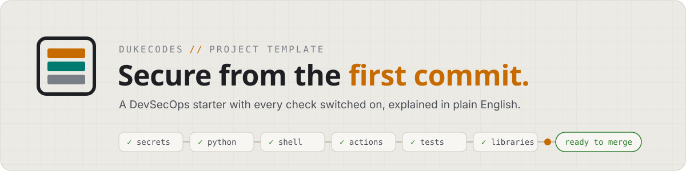

<picture>
  <source media="(prefers-color-scheme: dark)" srcset="docs/assets/banner-dark.svg">
  
</picture>

# dukecodes-project-template

**The starting point for every dukecodes project, lab and new device.** Security checks, tests and guardrails for AI helpers are switched on from the first commit, and every step is explained for people coming from outside tech.

`FACT` every check below runs in this repo's CI · `safe` to try: nothing here touches real infrastructure

## See it

The project page walks you through everything: a live pipeline, an attack simulator, the full runbook with saved progress, and a glossary. Open it locally:

```bash
make preview   # then open http://127.0.0.1:8000
```

## Start a new project

| # | Do | Why |
|---|----|-----|
| 1 | GitHub › **Use this template** › **Create a new repository** | A fresh repo with no shared history |
| 2 | `git clone <your repo>`, then `cd` into it | Work on your own machine |
| 3 | `make init NAME=my-project` | Renames the starter everywhere |
| 4 | `make setup` | Installs the tools and the checks that run on every commit |
| 5 | `make check` | Runs what CI runs, except the network scan. All `Passed` means ready |

New device with nothing installed? Open the repo in the dev container (VS Code › *Reopen in Container*, or a Codespace). It runs step 4 for you.

Stuck? Each step's expected output and how to undo it are in the page's runbook.

## The checks

| Check | Stops | Runs |
|-------|-------|------|
| gitleaks | Passwords and keys committed by mistake, now or anywhere in history | every commit, CI |
| ruff, mypy, pytest | Bugs, risky Python calls, wrong types, broken promises | every commit (ruff), CI |
| ShellCheck, yamllint | Shell traps and broken YAML | every commit, CI |
| actionlint, zizmor | Broken or unsafe GitHub Actions workflows | every commit, CI |
| Semgrep | Risky code patterns. Fails if no rules load | CI, `make scan` |
| Trivy | Libraries with known vulnerabilities, secrets in files, insecure Docker or infrastructure code | CI, `make scan` |
| dependency-review | A pull request that adds a library with a high-severity vulnerability | pull requests |
| page check | A weakened page lockdown, HTML from strings, edited design-system files | every commit, before every Pages deploy |
| policy tests | The cooldown, tool versions and pins drifting apart between files | CI, `make test` |
| Claude Code settings | An AI helper reading secrets, force-pushing, or running infrastructure commands | every Claude Code session |

## How it guards the supply chain

- **Pinned by commit.** Every GitHub Action and every commit hook is pinned to a full commit SHA, not a tag. A tag can be moved to point at other code; it happened to `trivy-action` in March 2026 (CVE-2026-33634).
- **A 7-day wait.** Dependabot, uv and the `uvx` tools all refuse releases younger than 7 days, so a hijacked release is usually caught before it reaches you. Dependabot's security updates skip the wait.
- **Exact tools.** CI installs one exact uv version, and the hook and scanner versions match between your machine and CI. `tests/test_policy.py` fails if any of these drift.

Need a fix that is newer than 7 days? Exempt only that package in `pyproject.toml`: `exclude-newer-package = { name = false }`. Remove it once the release is a week old.

## Commands

| Command | Does |
|---------|------|
| `make setup` | Install dependencies and the commit hooks |
| `make check` | Every hook on every file, types, tests, and a secret scan of the whole history |
| `make scan` | Semgrep and Trivy. Needs network and `trivy` |
| `make site-check` | Check the project page: lockdown, content, hash lock |
| `make preview` | Serve the page on this machine only |
| `make help` | List everything |

## Layout

```
.claude/        AI guardrails: deny and ask rules, hooks, rules per folder
.devcontainer/  ready-made workspace for new devices and Codespaces
.github/        CI, Pages deploy, Dependabot, CODEOWNERS, pull request and issue templates
docs/           STYLE.md (how we write), adr/ (decisions), runbooks/, assets/
scripts/        init, scan, and the page tools (check_site.py, ds_tokens.py)
site/           the project page: edit project.json; ds/ and vendor/ are locked copies
src/, tests/    Python starter and its tests (delete src/ for non-Python projects)
```

## Design

Every dukecodes repo uses the dukecodes design system, the look of Minirack Mission Control. It is copied into `site/ds/` and locked by hash, so the page loads nothing from other sites except its fonts. How to write: [`docs/STYLE.md`](docs/STYLE.md). How to update the copy: [`docs/runbooks/sync-design-system.md`](docs/runbooks/sync-design-system.md). Why it is built this way: [`docs/adr/0002-vendor-the-design-system.md`](docs/adr/0002-vendor-the-design-system.md).
