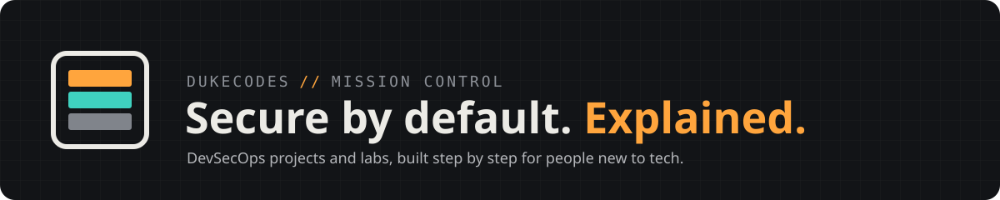

<p align="center"></p>

# dukecodes-project-template

**Base for every dukecodes DevSecOps project, lab, workspace and new device.** Security checks, tests and guardrails for AI helpers are on from the first commit, and every step is explained for people coming from outside tech.

`FACT` every gate below runs in CI on this repo · `safe` to try: nothing here touches real infrastructure

## Start a new project

| # | Do | Why |
|---|----|-----|
| 1 | GitHub › **Use this template** › **Create a new repository** (private) | Fresh repo, no shared history |
| 2 | `git clone <your repo>` then `cd` into it | Work on your own machine |
| 3 | `make init NAME=my-project` | Renames the starter everywhere |
| 4 | `make setup` | Installs tools and the commit-time security checks |
| 5 | `make check` | Runs every gate CI runs. All `Passed` = ready |

New device with nothing installed? Open the repo in the dev container (VS Code › *Reopen in Container*, or a Codespace). It runs step 4 for you.

The full walkthrough, with what to expect at each step and how to undo it, is on the project page: `site/` (published by GitHub Pages).

## Security gates

| Gate | Stops | Runs |
|------|-------|------|
| gitleaks | Passwords and keys committed by mistake | commit + CI |
| semgrep | Risky code patterns. Fails if no rules load | `make scan` + CI |
| trivy | Vulnerable dependencies, secrets, insecure Docker/IaC | `make scan` + CI |
| zizmor + actionlint | Unsafe or broken GitHub Actions | commit + CI |
| ruff, shellcheck, yamllint | Bugs in Python, shell, YAML | commit + CI |
| dependency-review | New dependency with a high-severity CVE | PRs |
| Claude guardrails | AI reading secrets, force-pushing, touching real infra | `.claude/settings.json` |

Every GitHub Action is pinned to an exact commit, not a tag. Tags can be moved by an attacker (it happened to `trivy-action` in March 2026). Dependabot proposes updates but waits 7 days, so bad releases get caught first.

## Layout

```
.claude/        AI guardrails: deny/ask rules, hooks, path-scoped rules
.devcontainer/  ready-made workspace for new devices and Codespaces
.github/        CI, Pages deploy, Dependabot, CODEOWNERS, PR/issue templates
docs/           STYLE.md (how we write), adr/ (decisions), runbooks/
scripts/        init + scan helpers
site/           project page: edit project.json; assets/ = shared Mission Control design
src/, tests/    Python starter (delete for non-Python projects)
```

## Design

Every dukecodes repo uses the Mission Control design system: tokens and components in `site/assets/`, writing rules in [`docs/STYLE.md`](docs/STYLE.md). This repo holds the canonical copy. Other repos sync from it instead of forking.

Preview the page locally: `python3 -m http.server -d site`, then open http://localhost:8000.
