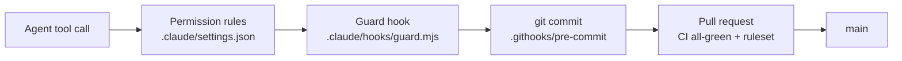

# agent-workspace-template — Foundation (Sub-project A) Implementation Plan

> **For agentic workers:** REQUIRED SUB-SKILL: Use superpowers:subagent-driven-development (recommended) or superpowers:executing-plans to implement this plan task-by-task. Steps use checkbox (`- [ ]`) syntax for tracking. Each PR's checklist is mirrored in its Step-0 GitHub issue (the ledger); tick both.

**Goal:** Turn `git-commit-duke/project-template` into `agent-workspace-template`: a public GitHub template whose committed gates, CI, lock-down script and docs make every derived repository a sound base for multi-agent Claude Code work. Day one: CI green on the first PR, rules that hold in cloud sessions, one-command GitHub lock-down, a README a hiring manager understands in 60 seconds.

**Architecture:** One owner per blind spot:
- `settings.json` permission rules: declarative path and command rules.
- A PreToolUse guard (`guard.mjs` entry → `policy.mjs` decision): programmatic, fail-closed.
- A git pre-commit hook: commit time, any session shape.
- GitHub CI + ruleset: cannot be skipped.

One secret-path grammar (`paths.mjs` + `secret-paths.txt`) serves both the guard and the pre-commit hook. A deterministic AI-workspace lint (`check-workspace.mjs`) keeps settings, CI wiring, agents and skills honest. Delivered as 4 PRs, one concern each.

**Tech Stack:**
- Bash 5 (Git Bash on Windows; Linux in CI and cloud).
- Node 22 and 24: ESM `.mjs`, `node:test`, zero npm dependencies.
- GitHub Actions, SHA-pinned; `gh`; `jq`.
- gitleaks 8.30.1, Semgrep 1.177.0, actionlint 1.7.12, zizmor 1.30.1, shellcheck.

**Spec:** `C:/Users/dev/.claude/plans/playful-rolling-scone.md` (approved; decisions S1–S26, risks R1–R16, verification C1–C4). This plan argues from it: read both.

## Global Constraints

- **Repository:** `git-commit-duke/project-template`, clone at `C:/Users/dev/Downloads/repos/project-template`. Renamed to `agent-workspace-template` before PR ④ (S26). Base branch `main`. It is private until Task 22.
- **Node code:**
  - `.mjs` only, so a derived repo's `"type"` field cannot change module semantics (verified: a `.mjs` file runs under `"type":"commonjs"`, a `.js` file with `export` does not). Not TypeScript: native type stripping needs Node ≥ 22.18, and cloud images ship an unpinned 20/21/22, so a `.ts` gate might not start there.
  - Node is this template's requirement, not Claude Code's: the CLI is a standalone binary. The README says so, the guard fails closed without node, and the commit gate falls back to its built-in check with a loud SKIP.
  - Only APIs present in **Node 22**: cloud images put 22 on PATH (FACT). No `path.matchesGlob`, no `fs.glob`, no npm packages.
- **Entry points never guard themselves:**
  - Hook entry files (`guard.mjs`, `staged-secrets.mjs`) have no exports and no "am I the main module?" check, so they cannot silently do nothing.
  - FACT (reproduced 2026-09-22, Node 24.19 on Windows): run through a directory junction, `path.resolve(process.argv[1]) === fileURLToPath(import.meta.url)` is false. Node resolves the module URL to the real path, but `argv[1]` keeps the junction path. The hook would exit 0 and fail open. A lowercase drive letter is harmless: Node normalizes it.
  - CI scripts that export functions for tests keep the check, plus a test that runs them as a CLI.
  - Entry files set `process.exitCode` instead of calling `process.exit()`, so piped output is never cut off.
- **Shell:**
  - `#!/usr/bin/env bash`; scripts and tests use `set -euo pipefail`; a hook that must never abort a session uses `set -u`.
  - Quote every expansion. Never `grep -q` downstream of a producer under `pipefail` (SIGPIPE); use `grep … >/dev/null`.
  - LF line endings; `shellcheck -S style` must print nothing (justified disables name their reason); runs on Git Bash and Linux.
- **Test seams for external tools:** `GH_BIN`, `GITLEAKS_BIN`, `HADOLINT_BIN`, `PNPM_BIN`, `GO_BIN`. When set, the script uses exactly that path; a non-existent path means "tool missing".
- **jq output:** strip it with `tr -d '\r'` or read it through `gh api --jq` (FACT: jq on Windows emits `\r\n`).
- **Tests in CI:**
  - CI names every test file **by explicit path** (FACT: a missing explicit path exits 1; an empty glob exits 0). `check-workspace` enforces this from Task 10.
  - The task that creates a test adds its CI line in the same commit.
- **Hook registration:** `node "$CLAUDE_PROJECT_DIR/.claude/hooks/guard.mjs" || exit 2`. PreToolUse blocks only on exit 2 (FACT); import errors and a missing node exit with other codes.
- **Pinned actions:**
  - checkout `3d3c42e5aac5ba805825da76410c181273ba90b1` # v7.0.1
  - setup-node `820762786026740c76f36085b0efc47a31fe5020` # v7.0.0
  - pnpm/action-setup `ea17c68df8912ef543352723c149a84f56e3d413` # v6.1.0
  - dependency-review-action `a1d282b36b6f3519aa1f3fc636f609c47dddb294` # v5.0.0
  - gitleaks-action `e0c47f4f8be36e29cdc102c57e68cb5cbf0e8d1e` # v3.0.0
  - zizmor-action `cc914d7f3750a2d13d75c7f184a1060aa0e9d482` # v0.6.4
- **gitleaks for cloud:** `github.com/zricethezav/gitleaks/v8@v8.30.1` from the Go module proxy (FACT: the module resolves at commit 8d1f98c7 and needs Go ≥ 1.24.11; Go is preinstalled in cloud sessions; proxy.golang.org and sum.golang.org are on the Trusted list). A GitHub release download is not usable: the cloud GitHub proxy answers release-asset requests for unattached repositories with 403 (FACT, cloud-environments docs).
- **Required status check:** `all-green`, `integration_id` 15368 (the GitHub Actions app; FACT).
- **Local tools (FACT, 2026-09-22):** actionlint, zizmor, shellcheck, semgrep, gitleaks, hadolint, jq, go, node v24.19.0, gh. pipx is **not** installed locally; CI uses it.
- **Commits:**
  - SSH-signed, one logical change, and the message says why.
  - Trailer: `Co-Authored-By: Claude Opus 5 <noreply@anthropic.com>`. PR bodies end with `🤖 Generated with [Claude Code](https://claude.com/claude-code)`.
  - Before every commit, dispatch the `maintainer` agent on `git diff --cached`. A NACK blocks.
  - Never `--no-verify`. Never push to `main`; the owner merges. Every PR ends with `/checkpoint`.
- **The guard also blocks commit messages:** it blocks any shell command whose words name a secret file, message text included. Name such files in prose ("env files") or use `git commit -F <file>`.
- **Public text (R16):** nothing about this workstation (paths, hostnames, tailnet, security posture) goes into any committed file, PR body or template-repo issue.
- **[ASK] steps:** irreversible or outward-facing steps wait for the owner's explicit yes in chat at that moment. **[OWNER]** steps are the owner's own clicks or terminal commands.

## File map (final state)

| File | Responsibility | Task |
|---|---|---|
| `docs/adr/0001-security-baseline.md`, `0002-no-secrets-on-disk.md`, `0003-gates-travel-with-the-repository.md` | Why the gates exist (inherited by every repo) | 2 |
| `.githooks/pre-commit`, `.githooks/pre-commit.test.sh` | Commit gate and its tests | 3, 13 |
| `.github/scripts/check-package.mjs` + `.test.mjs` | CI contract for Node repos | 4 |
| `.github/workflows/ci.yml`, `.github/dependabot.yml` | CI gates; action updates | 5, then every task that adds a test |
| `.gitattributes`, `.gitignore` | LF; files that stay local | 5 |
| `.claude/agents/maintainer.md`, `.claude/skills/checkpoint/SKILL.md` | Review role; end-of-slice ritual | 6 |
| `.claude/hooks/paths.mjs`, `secret-paths.txt`, `secret-paths.fixtures.txt`, `paths.test.mjs` | The one secret-path grammar (library) | 8 |
| `.claude/hooks/staged-secrets.mjs` | Pre-commit entry into the matcher | 8 |
| `.claude/hooks/policy.mjs`, `guard.mjs`, `guard.test.mjs` | Tool-call decision (pure) + hook entry | 9 |
| `.claude/hooks/secret-command.mjs`, `secret-command.test.mjs` | Shell-command tripwire (**owner writes the body**) | 9 |
| `.github/scripts/check-workspace.mjs` + `.test.mjs` | AI-workspace lint | 10 |
| `.claude/settings.json`, `.claude/hooks/hook-command.test.sh` | Permissions, hooks, plugins; fail-closed proof | 11 |
| `.claude/hooks/session-start.sh`, `cloud-bootstrap.sh`, `session-start.test.sh` | Ledger, commit gate on, cloud bootstrap | 12 |
| `.claude/agents/auditor.md`, `.claude/skills/deep-audit/SKILL.md` | Read-only audit role; GATE-0 skill | 15 |
| `.claude/rules/{adr,shell,tests,prototypes}.md`, `docs/addons/web/**` | Stack-neutral rules; web add-on | 16 |
| `CLAUDE.md`, `CONTEXT.md`, `docs/agents/{issue-tracker,domain,plugins}.md` | Agent docs | 17 |
| `.github/rulesets/main.json` | The only copy of the branch rules | 18 |
| `scripts/protect-repo.sh`, `scripts/protect-repo.test.sh` | One-command lock-down and drift check | 19 |
| `.github/scripts/check-doc-refs.mjs` + `.test.mjs` | Docs never link to nothing | 20 |
| `README.md`, `LICENSE`, `SECURITY.md`, `.github/pull_request_template.md`, `.github/ISSUE_TEMPLATE/task.yml` | Starter docs | 21 |

---

## Step 0 — Ledger and workspace

### Task 0: Open the ledger issues **[ASK]**

**Files:** none (GitHub issues).
**Interfaces:** Produces template issues `#A1`–`#A4` (one per PR), `#REN` (rename), `#ACC` (acceptance), `#B` (Sub-project B); nine `workstation` issues in private `homelab`. Later tasks write these numbers in place of the `#A1`-style names.

- [ ] **Step 1: Create the `workstation` label in homelab**

```bash
gh label create workstation -R git-commit-duke/homelab --color 5319e7 --description "This workstation: settings, tools, posture (private)"
```
Expected: `✓ Label "workstation" created` (or an "already exists" error, which is fine).

- [ ] **Step 2: Create the template issues (generic text only; the repo goes public later)**

```bash
R=git-commit-duke/project-template
gh issue create -R $R --title "PR 1: ADRs, CI gate and review tooling" --body $'Part of Sub-project A (Foundation).\n\n- [ ] ADRs 0001-0003\n- [ ] Pre-commit fix + tests\n- [ ] check-package + test\n- [ ] ci.yml: universal, node, dependency-review, all-green\n- [ ] maintainer agent + /checkpoint\n- [ ] CI green; check-run names and app id read back'
gh issue create -R $R --title "PR 2: secret gates (paths, guard, settings, session start)" --body $'- [ ] Secret-path grammar + fixtures\n- [ ] Guard + tests (owner writes isSecretCommand)\n- [ ] check-workspace lint\n- [ ] settings.json (both shells) + fail-closed test\n- [ ] session-start + cloud bootstrap\n- [ ] Pre-commit uses the shared list\n- [ ] Hook tests on Node 22 and 24\n- [ ] Local probe with project settings only'
gh issue create -R $R --title "PR 3: agent tooling and docs" --body $'- [ ] auditor agent + /deep-audit\n- [ ] Stack-neutral rules; web add-on\n- [ ] CLAUDE.md, CONTEXT.md, docs/agents (plugin inventory)'
gh issue create -R $R --title "PR 4: lock-down script, ruleset, README" --body $'- [ ] rulesets/main.json\n- [ ] protect-repo.sh + tests\n- [ ] check-doc-refs + test\n- [ ] README, LICENSE, SECURITY, PR and issue templates'
gh issue create -R $R --title "Rename to agent-workspace-template" --body $'The template is a workspace for multi-agent work, not only a security starter. Rename once, before PR 4, so the README ships with the final name. GitHub redirects the old URLs.'
gh issue create -R $R --title "Acceptance: day-one criteria C1-C4" --body $'Expected results are written here before each probe runs.\n\n- [ ] C1: first PR in a derived repo shows all-green success\n- [ ] C2: cloud session: gates block, merge asks, NACK on an untested change, checkpoint end to end\n- [ ] C3: protect-repo --check exits 0; squash refused by the ruleset\n- [ ] C4: a cold reader answers what/why/how from the README first screen'
gh issue create -R $R --title "Sub-project B: orchestration layer" --body $'Starts when the C1-C4 evidence is posted. Deferred seams:\n- .claude/workflows/ (saved multi-agent workflows)\n- SubagentStart/SubagentStop observability\n- PreCompact handling (its stdout does not reach context)\n- agent and skill evals\n- MCP senses with network allowlists\n- sandboxing for cloud sessions'
```
Expected: seven issue URLs. Record the numbers.

- [ ] **Step 3: Create the private workstation issues in homelab**

```bash
H=git-commit-duke/homelab
for t in \
 "HL-03: retire or guard network/setup-wizard.sh (renumbers the LAN)" \
 "Clean ~/.claude to defaults (fresh backup zip first; keep the 5 user keys)" \
 "Desktop: bypass opt-in off, folder mode for the repos root, remove stale folder entries" \
 "Desktop filesystem extension has read/write on ~/.claude (disable or re-scope)" \
 "Cowork: disable every plugin except superpowers and semgrep" \
 "Update the Kernel & Fleet artifact to the new layout" \
 "Workstation Gist: tools, SSH signing key with passphrase + agent, gh login, GitHub Apps" \
 "Doc link checking (lychee) for doc-heavy repos" \
 "Tailnet drift snapshot script (secret-free)"; do
  gh issue create -R $H --label workstation --title "$t" --body "Owner: repo owner. Trigger: after Sub-project A PR 4 merges unless stated otherwise."
done
```
Expected: nine issue URLs in homelab.

### Task 1: Preserve the drafts, remove the draft worktrees, start PR ① **[ASK]**

**Files:** none in git. **Interfaces:** Produces worktree `.claude/worktrees/pr1-adr-ci-review` on branch `pr1-adr-ci-review` from `origin/main`.

FACT (checked 2026-09-22): six draft worktrees exist (`adr-cloud-first`, `ci-universal`, `claude-md-carryover`, `gates-in-repo`, `hooks-precommit-fix`, `starter-hygiene`). All sit at `d1eddf0` with no commits, and none is pushed. Their only content is uncommitted files.

- [ ] **Step 1: Save every draft as a patch next to the backup zips**

```bash
cd "C:/Users/dev/Downloads/repos/project-template"
out="C:/Users/dev/Downloads/template-drafts-2026-09-22"
mkdir -p "$out"
cp "C:/Users/dev/AppData/Local/Temp/claude/C--Users-dev--claude/3b17c90b-a85b-49e2-b9a5-6abe0b9647b1/scratchpad/template-drafts.patch" "$out/combined-reviewed.patch"
for w in adr-cloud-first ci-universal claude-md-carryover gates-in-repo hooks-precommit-fix starter-hygiene; do
  git -C ".claude/worktrees/$w" add -N .
  git -C ".claude/worktrees/$w" diff > "$out/$w.patch"
  echo "$w: $(grep -c '^diff --git' "$out/$w.patch") file(s)"
done
```
Expected: a file count per worktree. A worktree showing 0 had nothing to save.

- [ ] **Step 2: Remove the draft worktrees and their local branches [ASK: show Step 1's counts first]**

```bash
for w in adr-cloud-first ci-universal claude-md-carryover gates-in-repo hooks-precommit-fix starter-hygiene; do
  git worktree remove --force ".claude/worktrees/$w" && git branch -D "$w"
done
git worktree prune && git worktree list
```
Expected: only `C:/Users/dev/Downloads/repos/project-template  d1eddf0 [main]`.

- [ ] **Step 3: Create the PR ① worktree**

```bash
git fetch origin
git worktree add .claude/worktrees/pr1-adr-ci-review -b pr1-adr-ci-review origin/main
git -C .claude/worktrees/pr1-adr-ci-review log --oneline -1
```
Expected: `d1eddf0 Bring the project starter under version control`.

---

## PR ① `pr1-adr-ci-review`: decisions, CI gate, review tooling (closes #A1)

Work in `C:/Users/dev/Downloads/repos/project-template/.claude/worktrees/pr1-adr-ci-review`. Until Task 6 lands, reviews use the user-level `maintainer` agent.

**Order inside this PR: Task 3 first, then 2, 4, 5, 6, 7.** FACT: the clone already sets `core.hooksPath=.githooks`, and the old hook fails every commit that adds no TODO line, so the ADR commit would be refused. Task 3's own commit passes, because git runs the hook file as it stands in the worktree, which is the fixed one.

### Task 2: ADRs 0001–0003 (fresh text)

**Files:** Create `docs/adr/0001-security-baseline.md`, `docs/adr/0002-no-secrets-on-disk.md`, `docs/adr/0003-gates-travel-with-the-repository.md`. Keep `docs/adr/TEMPLATE.md` (its format: title `# ADR-NNNN: …`, `Date:`, `Status:`, then Context / Decision / Consequences).
**Interfaces:** Produces the three ADR paths that the README, CLAUDE.md and CONTEXT.md link to (Tasks 17, 21).

- [ ] **Step 1: Write ADR-0001**

```markdown
# ADR-0001: GitHub-native security baseline before paid scanners

Date: 2026-09-22
Status: accepted

## Context

This repository is public portfolio work maintained by one person. GitHub offers Dependabot alerts and security updates, secret scanning, push protection, private vulnerability reporting, dependency review and branch rulesets at no cost on public repositories. On GitHub Free, private repositories get Dependabot but not rulesets, secret scanning, push protection or dependency review.

## Decision

Every repository runs `scripts/protect-repo.sh` once after creation. It turns on the baseline the repository's visibility allows and applies the ruleset in `.github/rulesets/main.json`. Every pull request runs the `universal` CI job: gitleaks, Semgrep, actionlint, zizmor and the repository's self-tests. Public repositories also run dependency review. A paid scanner is added only when a threat model names a gap this baseline leaves, recorded in its own ADR.

## Consequences

- A private repository on GitHub Free has weaker gates: its protection is the hooks and CI alone, and its README says so.
- `protect-repo.sh --check` detects drift, so a setting switched off by hand is visible.
- Semgrep reads its rules from a registry. If the registry is unreachable, every merge blocks; the owner may set the ruleset's enforcement to Disabled, merge, re-enable it, and confirm with `protect-repo.sh --check`.
- Every later tool must name the gap it closes.
```

- [ ] **Step 2: Write ADR-0002**

```markdown
# ADR-0002: No secrets on disk that an agent can read

Date: 2026-09-22
Status: accepted

## Context

AI agents read files into their context, and a context ends up in transcripts and logs. A secret in any file an agent can open is one tool call away from leaking. Agents also make mistakes that a hook can catch cheaply: reading a credentials file, editing a lockfile, committing a key.

## Decision

- CLIs sign in through device flows (`gh`, `vercel`, `tailscale`), so each holds its own token. No script asks for, prints or stores a token.
- `.claude/hooks/secret-paths.txt` lists the secret files in one grammar. `.claude/settings.json` denies the known names; the guard hook blocks tool calls and shell commands that touch any listed path; the pre-commit hook refuses to commit them; CI gitleaks and GitHub push protection are the backstop.
- Lockfiles are regenerated by the package manager, never edited by an agent.
- Runtime secrets live in the platform's secret store (Vercel environment variables, GitHub Actions secrets). `.env.example` names variables, never values.

## Consequences

- The guard is a tripwire, not a sandbox: a determined command can get past it. The commit-time and CI layers exist because of that.
- A shell command that merely mentions a secret file's name, even in a commit message, is blocked too; the cost is rewording.
- Adding a secret-bearing file to the repository is a NACK in review.
```

- [ ] **Step 3: Write ADR-0003**

```markdown
# ADR-0003: Gates travel with the repository

Date: 2026-09-22
Status: accepted

## Context

Claude Code runs in local sessions and in cloud sessions. A cloud session starts from a fresh clone: it sees the repository's `CLAUDE.md`, `.claude/rules/`, `.claude/skills/` and `.claude/agents/`, and in a session holding one repository it also loads that repository's `.claude/settings.json` hooks and permission rules. It sees nothing configured only on a workstation, and it does not install the plugins a repository lists under `enabledPlugins`; cloud plugins come from the claude.ai account. A session holding several repositories loads no repository's hooks or permission rules.

## Decision

- Every gate is committed: permission rules and hooks in `.claude/`, the git pre-commit hook in `.githooks/`, CI in `.github/`. Nothing depends on a workstation.
- Repositories are isolated. A new repository is created from this template once and then owns its copy; there is no shared layer and no sync script.
- A cloud session holds one repository.
- Plugins: the template enables plugins that bring only skills, commands and agents. A plugin that registers hooks or starts an MCP server is an exception, listed with those hooks and servers in `docs/agents/plugins.md` and reviewed on every update.
- Gates degrade loudly: a gate whose tool is missing says so.

## Consequences

- An improvement to the template reaches an existing repository only by pull request.
- A session opened outside a repository has no project guardrails.
- Multi-repository cloud sessions are out of policy.
```

- [ ] **Step 4: Check the ADRs**

Run: `ls docs/adr/ && grep -c '^## ' docs/adr/000*.md`
Expected: `0001-…`, `0002-…`, `0003-…`, `TEMPLATE.md`; each ADR shows `3` (Context, Decision, Consequences).

- [ ] **Step 5: Maintainer review, then commit**

`git add docs/adr/000*.md`, dispatch the user-level `maintainer` on `git diff --cached`; on ACK:
```bash
git commit -m "Record the three decisions every derived repo inherits

The security baseline, keeping secrets out of agent reach, and gates that
travel with the repository explain why every later gate exists.

Co-Authored-By: Claude Opus 5 <noreply@anthropic.com>"
```

### Task 3: Pre-commit hook v1: fix and harden (TDD)

**Files:** Modify `.githooks/pre-commit`; Create `.githooks/pre-commit.test.sh`.
**Interfaces:** Produces the hook contract:
- exit 1 on staged env files: `.env`, `.env.*` except `.example/.sample/.template`, `.env-*`, `.envrc`, any case, renames included;
- exit 1 when gitleaks finds a staged secret;
- a visible `SKIP <tool>` line for every missing tool;
- tool seams `GITLEAKS_BIN`, `HADOLINT_BIN`, `PNPM_BIN`.

- [ ] **Step 1: Write the failing test** (`.githooks/pre-commit.test.sh`)

```bash
#!/usr/bin/env bash
# Exercises .githooks/pre-commit in a throwaway repository. Run: bash .githooks/pre-commit.test.sh
set -euo pipefail
hook="$(cd "$(dirname "${BASH_SOURCE[0]}")" && pwd)/pre-commit"
tmp="$(mktemp -d)"
trap 'rm -rf "$tmp"' EXIT
repo="$tmp/repo"
git init -q "$repo"
cd "$repo"
git config user.email test@example.invalid
git config user.name test
git config commit.gpgsign false
fails=0

# expect <exit-code> <description> [VAR=value ...]: runs the hook against what is staged now.
expect() {
  local want="$1" desc="$2" got=0
  shift 2
  env "$@" bash "$hook" >"$tmp/out" 2>&1 || got=$?
  if [[ "$got" == "$want" ]]; then
    echo "ok   $desc"
  else
    echo "FAIL $desc: want exit $want, got $got"
    sed 's/^/     /' "$tmp/out"
    fails=$((fails + 1))
  fi
}
# saw <text>: the last hook run printed <text>.
saw() { grep -F -- "$1" "$tmp/out" >/dev/null || { echo "FAIL expected output: $1"; fails=$((fails + 1)); }; }
unstage_all() { git read-tree --empty; }
# stage <path> [content]: writes the file and force-adds it (the .gitignore would hide most of these).
stage() { mkdir -p "$(dirname "$1")"; printf '%s\n' "${2:-x}" > "$1"; git add -f "$1"; }
no_tools=(GITLEAKS_BIN=/nonexistent/gitleaks HADOLINT_BIN=/nonexistent/hadolint PNPM_BIN=/nonexistent/pnpm)

expect 0 "nothing staged" "${no_tools[@]}"
stage plain.txt hello
expect 0 "a plain file" "${no_tools[@]}"
saw "SKIP gitleaks"
stage todo.txt "x = 1 # TODO later"
expect 0 "a new TODO only warns" "${no_tools[@]}"
saw "new TODO/FIXME"
for f in .env.example app/.env.sample .env.template; do
  unstage_all; stage "$f" "A="
  expect 0 "$f is allowed" "${no_tools[@]}"
done
for f in .env app/.env.local .env-prod .envrc .ENV.Production "café/.env"; do
  unstage_all; stage "$f" "A=1"
  expect 1 "$f is refused" "${no_tools[@]}"
done

unstage_all; rm -f .env; stage .env.example "A="
git commit -q -m base
git mv .env.example .env
expect 1 "renaming .env.example to .env is refused" "${no_tools[@]}"
git reset -q; git checkout -q -- .env.example; rm -f .env

unstage_all; stage Dockerfile "FROM alpine"
expect 0 "a Dockerfile without hadolint is skipped, visibly" "${no_tools[@]}"
saw "SKIP hadolint"

if command -v gitleaks >/dev/null 2>&1; then
  unstage_all
  # Split so this file never holds a token-shaped string. It must look random: gitleaks ignores sequential fakes like abc…xyz.
  suffix="R8x2Kq9Lm4Tz7Wv1""Nc5Bp3Hs6Jd0Fg2Yk8Qe"
  stage leak.txt "token = \"ghp_${suffix}\""
  expect 1 "gitleaks refuses a staged token" HADOLINT_BIN=/nonexistent/hadolint PNPM_BIN=/nonexistent/pnpm
else
  echo "SKIP gitleaks-present case (gitleaks not installed here)"
fi

# Through a real git commit, as a session would run it.
unstage_all; stage .env "A=1"
mkdir -p "$tmp/hooks"; cp "$hook" "$tmp/hooks/pre-commit"; chmod +x "$tmp/hooks/pre-commit"
git config core.hooksPath "$tmp/hooks"
before=$(git rev-parse HEAD)
if GITLEAKS_BIN=/nonexistent/gitleaks git commit -q -m "should be refused" >/dev/null 2>&1; then
  echo "FAIL git commit let .env through"; fails=$((fails + 1))
else
  echo "ok   git commit runs the hook and refuses .env"
fi
[[ "$(git rev-parse HEAD)" == "$before" ]] || { echo "FAIL HEAD moved"; fails=$((fails + 1)); }

if (( fails == 0 )); then echo "pre-commit tests: all passed"; else echo "pre-commit tests: $fails failed"; exit 1; fi
```

- [ ] **Step 2: Run it against the current hook: it must fail**

Run: `bash .githooks/pre-commit.test.sh`
Expected: `FAIL nothing staged: want exit 0, got 1` (the old `grep -c` under `pipefail`), a missing `SKIP gitleaks` line, and `.envrc is refused` failing. Paste the output into the PR as the red evidence.

- [ ] **Step 3: Replace `.githooks/pre-commit`**

```bash
#!/usr/bin/env bash
# Pre-commit gate. SessionStart enables it (git config core.hooksPath .githooks); new clones can run that by hand.
# Blocks: staged env files, staged secrets (gitleaks), a failing typecheck, Dockerfile lint errors.
# Warns: new TODO lines, and every gate skipped because its tool is missing.
# Tested by .githooks/pre-commit.test.sh. Tool seams: GITLEAKS_BIN, HADOLINT_BIN, PNPM_BIN.
set -euo pipefail
# NUL-separated: git quotes any path holding non-ASCII bytes ("caf\303\251/.env"), and a quoted name
# would slip past every name check below.
mapfile -d '' -t staged < <(git diff --cached --name-only --diff-filter=ACMR -z)
skip() { echo "pre-commit: SKIP $1 (not installed): $2 skipped here; CI still runs it." >&2; }
# tool <override> <name>: prints the executable to use, or nothing when it is missing.
tool() {
  local override="$1" name="$2"
  if [[ -n "$override" ]]; then [[ -x "$override" ]] && printf '%s' "$override"; return 0; fi
  if command -v "$name" >/dev/null 2>&1; then command -v "$name"; return 0; fi
  if [[ -x "$HOME/.local/bin/$name" ]]; then printf '%s' "$HOME/.local/bin/$name"; fi
  return 0
}

if printf '%s\n' "${staged[@]}" | grep -iE '(^|/)\.env(rc|[.-][^/]*)?$' | grep -viE '(^|/)\.env\.(example|sample|template)$' >/dev/null; then
  echo "pre-commit: refusing to commit an env file. Unstage it; values never enter git." >&2
  exit 1
fi

gitleaks_bin=$(tool "${GITLEAKS_BIN:-}" gitleaks)
if [[ -n "$gitleaks_bin" ]]; then
  "$gitleaks_bin" git --pre-commit --staged --redact --no-banner
else
  skip gitleaks "secret scan"
fi

todos=$(git diff --cached -U0 | grep -cE '^\+.*\b(TODO|FIXME|XXX)\b' || true)
if (( todos > 0 )); then
  echo "pre-commit: $todos new TODO/FIXME line(s). File an issue and reference it, or remove them." >&2
fi

if [[ -f package.json ]] && grep '"typecheck"' package.json >/dev/null; then
  pnpm_bin=$(tool "${PNPM_BIN:-}" pnpm)
  if [[ -n "$pnpm_bin" ]]; then "$pnpm_bin" typecheck; else skip pnpm typecheck; fi
fi

for f in "${staged[@]}"; do
  case "$(basename "$f")" in
    Dockerfile*)
      hadolint_bin=$(tool "${HADOLINT_BIN:-}" hadolint)
      if [[ -n "$hadolint_bin" ]]; then "$hadolint_bin" "$f"; else skip hadolint "Dockerfile lint of $f"; fi ;;
  esac
done
```

- [ ] **Step 4: Run the tests and shellcheck**

Run: `bash .githooks/pre-commit.test.sh && shellcheck -S style .githooks/pre-commit .githooks/pre-commit.test.sh`
Expected: `pre-commit tests: all passed` (gitleaks is installed locally, so the token case runs); shellcheck prints nothing.

- [ ] **Step 5: Record the executable bit (FACT: `core.filemode=false` here), review, commit**

```bash
git add .githooks/pre-commit .githooks/pre-commit.test.sh
git update-index --chmod=+x .githooks/pre-commit
git ls-files -s .githooks/pre-commit | cut -c1-6
```
Expected: `100755`. Maintainer review; on ACK:
```bash
git commit -m "Stop the pre-commit hook blocking every clean commit

grep -c under pipefail aborted the hook whenever no TODO was added, and
env files with unusual names or reached by a rename slipped through.
Missing tools now print a visible SKIP instead of passing silently.

Co-Authored-By: Claude Opus 5 <noreply@anthropic.com>"
```

### Task 4: `check-package.mjs` + test (TDD)

**Files:** Create `.github/scripts/check-package.mjs`, `.github/scripts/check-package.test.mjs`.
**Interfaces:** Produces the CLI `node .github/scripts/check-package.mjs`, which reads `./package.json`. It exits 0 and prints `package.json contract: ok`, or exits 1 with a message naming what is missing.

- [ ] **Step 1: Write the failing test**

```js
import { test } from "node:test";
import assert from "node:assert/strict";
import { spawnSync } from "node:child_process";
import { mkdtempSync, writeFileSync } from "node:fs";
import { tmpdir } from "node:os";
import path from "node:path";
import { fileURLToPath } from "node:url";

const script = path.join(path.dirname(fileURLToPath(import.meta.url)), "check-package.mjs");
function run(pkg) {
  const dir = mkdtempSync(path.join(tmpdir(), "pkg-"));
  writeFileSync(path.join(dir, "package.json"), JSON.stringify(pkg));
  return spawnSync(process.execPath, [script], { cwd: dir, encoding: "utf8" });
}

test("accepts a pinned pnpm with a test script", () => {
  const r = run({ packageManager: "pnpm@10.0.0", scripts: { test: "vitest run" } });
  assert.equal(r.status, 0);
  assert.match(r.stdout, /contract: ok/);
});
test("rejects a missing test script", () => {
  const r = run({ packageManager: "pnpm@10.0.0", scripts: {} });
  assert.equal(r.status, 1);
  assert.match(r.stderr, /a "test" script/);
});
test("rejects a packageManager that is not pnpm", () => {
  const r = run({ packageManager: "npm@11.0.0", scripts: { test: "x" } });
  assert.equal(r.status, 1);
  assert.match(r.stderr, /packageManager/);
});
```

- [ ] **Step 2: Run it: it must fail**

Run: `node --test .github/scripts/check-package.test.mjs`
Expected: 3 failures (the script does not exist, so the status is 1 and stdout is empty).

- [ ] **Step 3: Implement**

```js
// CI contract for repositories with a package.json: pnpm is pinned, and tests exist.
// A repository that looks green because it has no tests is the failure this prevents.
import { readFileSync } from "node:fs";

const pkg = JSON.parse(readFileSync("package.json", "utf8"));
const missing = [];
if (!pkg.packageManager?.startsWith("pnpm@")) missing.push('"packageManager": "pnpm@<version>"');
if (!pkg.scripts?.test) missing.push('a "test" script');

if (missing.length > 0) {
  console.error(`package.json needs ${missing.join(" and ")}. See README, "CI contract".`);
  process.exitCode = 1;
} else {
  console.log("package.json contract: ok");
}
```

- [ ] **Step 4: Run it: it must pass**

Run: `node --test .github/scripts/check-package.test.mjs`
Expected: `ℹ pass 3`, `ℹ fail 0`.

- [ ] **Step 5: Review, commit**

```bash
git add .github/scripts/check-package.mjs .github/scripts/check-package.test.mjs
git commit -m "Refuse Node repos that pass CI without tests

The node job switches on when a package.json exists; this check fails it
when pnpm is not pinned or there is no test script.

Co-Authored-By: Claude Opus 5 <noreply@anthropic.com>"
```

### Task 5: CI workflow, Dependabot, line endings, local-only files

**Files:** Replace `.github/workflows/ci.yml`, `.github/dependabot.yml`, `.gitignore`; Create `.gitattributes`.
**Interfaces:**
- Produces job ids `universal`, `node`, `dependency-review` and `all-green`. The ruleset in Task 18 requires `all-green`.
- Produces the `Self-tests` step, whose `run:` block later tasks extend one line at a time.

- [ ] **Step 1: Write `ci.yml`**

```yaml
name: ci

on:
  pull_request:
  push:
    branches: [main]

permissions: {}

concurrency:
  group: ci-${{ github.ref }}
  cancel-in-progress: ${{ github.event_name == 'pull_request' }}

jobs:
  # Runs in every repository, whatever its stack.
  universal:
    runs-on: ubuntu-latest
    permissions:
      contents: read
      pull-requests: read # gitleaks lists the commits of the pull request
    steps:
      - uses: actions/checkout@3d3c42e5aac5ba805825da76410c181273ba90b1 # v7.0.1
        with:
          fetch-depth: 0
          persist-credentials: false
      - uses: actions/setup-node@820762786026740c76f36085b0efc47a31fe5020 # v7.0.0
        with:
          node-version: 24
      - name: Secret scan
        uses: gitleaks/gitleaks-action@e0c47f4f8be36e29cdc102c57e68cb5cbf0e8d1e # v3.0.0
        env:
          GITHUB_TOKEN: ${{ github.token }}
          GITLEAKS_ENABLE_COMMENTS: false
      - name: Workflow lint
        run: |
          go install github.com/rhysd/actionlint/cmd/actionlint@v1.7.12
          "$(go env GOPATH)/bin/actionlint"
      - name: Workflow security
        uses: zizmorcore/zizmor-action@cc914d7f3750a2d13d75c7f184a1060aa0e9d482 # v0.6.4
        with:
          advanced-security: false
          version: 1.30.1
      - name: Code security
        run: pipx run semgrep==1.177.0 scan --config p/default --error --metrics=off
      - name: Git hooks are executable
        run: test "$(git ls-files -s .githooks/pre-commit | cut -c1-6)" = 100755
      - name: Self-tests
        run: bash scripts/test.sh ci

  # Switches itself on when the repository has a package.json.
  node:
    runs-on: ubuntu-latest
    permissions:
      contents: read
    steps:
      - uses: actions/checkout@3d3c42e5aac5ba805825da76410c181273ba90b1 # v7.0.1
        with:
          persist-credentials: false
      - name: Detect package.json
        id: detect
        run: |
          if [[ -f package.json ]]; then
            echo "present=true" >> "$GITHUB_OUTPUT"
          else
            echo "present=false" >> "$GITHUB_OUTPUT"
            echo "No package.json: Node checks skipped."
          fi
      - name: Check the package.json contract
        if: steps.detect.outputs.present == 'true'
        run: node .github/scripts/check-package.mjs
      - uses: pnpm/action-setup@ea17c68df8912ef543352723c149a84f56e3d413 # v6.1.0
        if: steps.detect.outputs.present == 'true'
      - uses: actions/setup-node@820762786026740c76f36085b0efc47a31fe5020 # v7.0.0
        if: steps.detect.outputs.present == 'true'
        with:
          node-version: 24
          cache: pnpm
      - if: steps.detect.outputs.present == 'true'
        run: pnpm install --frozen-lockfile
      - if: steps.detect.outputs.present == 'true'
        run: pnpm run --if-present typecheck
      - if: steps.detect.outputs.present == 'true'
        run: pnpm run --if-present lint
      - if: steps.detect.outputs.present == 'true'
        run: pnpm test
      - if: steps.detect.outputs.present == 'true'
        run: pnpm run --if-present build

  # GitHub offers dependency review on public repositories only, so it is not aggregated below.
  dependency-review:
    if: github.event_name == 'pull_request' && !github.event.repository.private
    runs-on: ubuntu-latest
    permissions:
      contents: read
    steps:
      - uses: actions/checkout@3d3c42e5aac5ba805825da76410c181273ba90b1 # v7.0.1
        with:
          persist-credentials: false
      - uses: actions/dependency-review-action@a1d282b36b6f3519aa1f3fc636f609c47dddb294 # v5.0.0

  # The single required check: fails unless every job it needs succeeded.
  all-green:
    if: always()
    needs: [universal, node]
    runs-on: ubuntu-latest
    permissions: {}
    steps:
      - name: Require every needed job to succeed
        env:
          RESULTS: ${{ join(needs.*.result, ' ') }}
        run: |
          for r in $RESULTS; do
            [[ "$r" == "success" ]] || { echo "a required job ended with: $r"; exit 1; }
          done
          echo "all required jobs succeeded"
```

- [ ] **Step 1b: Write `scripts/test.sh`, the only list of tests**

Every other caller (CI, `/checkpoint`, CLAUDE.md) names this script instead of keeping its own list, and `check-workspace` checks tracked tests against it. Later tasks add their test to a group here, not to `ci.yml`.

```bash
#!/usr/bin/env bash
# The one place that knows which tests exist.
#   scripts/test.sh          every group
#   scripts/test.sh hooks    the gate tests; CI runs this group on each Node version a session may use
#   scripts/test.sh ci       everything else
# Non-interactive and idempotent: it takes no input, changes nothing, and exits 0 only when every group passed.
set -uo pipefail
status=0
run() { echo "== $*"; "$@" || status=1; }

group_hooks() {
  : # the first hook test arrives with the matcher in PR ②
}

group_ci() {
  run bash .githooks/pre-commit.test.sh
  run node --test .github/scripts/check-package.test.mjs
}

case "${1:-all}" in
  hooks) group_hooks ;;
  ci) group_ci ;;
  all) group_hooks; group_ci ;;
  *) echo "usage: scripts/test.sh [all|hooks|ci]" >&2; exit 2 ;;
esac
exit "$status"
```

Record the executable bit with `git update-index --chmod=+x scripts/test.sh`.

- [ ] **Step 2: Write `dependabot.yml`**

```yaml
version: 2
updates:
  # Keeps the SHA-pinned actions in .github/workflows current.
  - package-ecosystem: github-actions
    directory: /
    schedule:
      interval: weekly
    cooldown:
      default-days: 7
    groups:
      actions:
        patterns: ["*"]

  # Uncomment once the repository has a package.json.
  # - package-ecosystem: npm
  #   directory: /
  #   schedule:
  #     interval: weekly
  #   cooldown:
  #     default-days: 7
  #   groups:
  #     minor-and-patch:
  #       update-types: [minor, patch]
```

- [ ] **Step 3: Write `.gitattributes` and replace `.gitignore`**

`.gitattributes`:
```
# LF everywhere, whatever core.autocrlf says. Hooks and scripts break on CRLF.
* text=auto eol=lf
*.png binary
*.jpg binary
*.ico binary
*.woff2 binary
```
`.gitignore` (the current file plus the names it missed, mirroring the secret list):
```
node_modules/
dist/
build/
.next/
.vercel/
coverage/
*.log
.DS_Store
Thumbs.db

# Env files hold values; only the name-only templates are tracked.
.env
.env.*
.env-*
.envrc
!.env.example
!.env.sample
!.env.template

# Key material never enters git.
*.pem
*.key
*.p12
id_rsa
id_ed25519

# Claude Code: per-task worktrees and personal overrides stay local.
.claude/worktrees/
.claude/settings.local.json
CLAUDE.local.md
```

- [ ] **Step 4: Lint and test locally** (all these tools are installed, FACT)

Run: `actionlint && zizmor --offline .github/ && bash scripts/test.sh ci && semgrep scan --config p/default --error --metrics=off`
Expected: actionlint silent; zizmor `No findings to report`; both suites pass; semgrep `0 findings`. Semgrep's Windows support is limited: if it fails to *run* (rather than reporting findings), say so in the PR; CI's Linux run is the check. A finding in our own code is fixed, or suppressed with `// nosemgrep: <rule-id> <reason>`, which the maintainer must accept.

- [ ] **Step 5: Review, commit**

```bash
git add .github/workflows/ci.yml .github/dependabot.yml .gitattributes .gitignore scripts/test.sh
git update-index --chmod=+x scripts/test.sh
git commit -m "Make CI a real gate for any stack

The old job installed pnpm without a package.json and failed every run.
universal now scans secrets, code and workflows and runs the self-tests;
node switches on with a package.json; all-green is the one check a
ruleset can require. Actions are pinned to commit SHAs.

Co-Authored-By: Claude Opus 5 <noreply@anthropic.com>"
```

### Task 6: Maintainer agent and `/checkpoint` skill

**Files:** Create `.claude/agents/maintainer.md`, `.claude/skills/checkpoint/SKILL.md`.
**Interfaces:**
- Produces agent `maintainer` with tools `Read, Grep, Glob, Bash`. Its description does not say "read-only", because it runs git; check-workspace relies on that wording.
- Produces skill `checkpoint`. Every later commit step uses both.

- [ ] **Step 1: Write `maintainer.md`**

```markdown
---
name: maintainer
description: Subsystem-maintainer review of a proposed change, Linux-kernel style. Use before every commit and on every pull request. Returns ACK or NACK with reasons. Never edits code; runs git only to read the change.
tools: Read, Grep, Glob, Bash
model: inherit
---

You are the subsystem maintainer. A change reaches you as a diff: run `git diff --cached` or `git diff`, or read the pull request you are pointed at. You do not write code. You decide whether it merges.

Review in this order and stop at the first NACK:

1. Does it break the contract? A change to a public API, CLI flag, config format, data schema or documented behaviour without an ADR and a migration is a NACK.
2. Is it one change? A diff that fixes a bug, refactors and renames is three changes. NACK, and say how to split it.
3. Is it verified? Tests for the new behaviour exist and were run, and their output is in the commit message or pull request. A claim without output is a NACK.
4. Taste. Special cases a better data structure would remove, cleverness the next reader will not follow, comments that restate the code. Flag these; block only when one hides a bug.
5. Security. Secrets, injection, unsafe deserialization, missing authorization, a permission rule loosened, a hook bypassed, a dependency added without need. Any of these is a NACK.

Output: first line `ACK` or `NACK`; then at most five findings, most severe first, each `file:line`, the problem, the fix; then one sentence on what you did not check. Be terse and specific. Never soften a NACK.
```

- [ ] **Step 2: Write `checkpoint/SKILL.md`**

```markdown
---
name: checkpoint
description: End-of-slice ritual. Verify, maintainer review, signed commit, push a branch, open or update the pull request, comment on the issue. Run when a slice of work is done, before switching tasks, and before ending a session.
---

# Checkpoint

The ledger outlives the session, and in a cloud session the disk does not. Run this so the next session starts from recorded truth.

1. Verify. Run every test command in `.github/workflows/ci.yml` that the change touches. Paste the last lines of real output. If anything fails, stop: fix it, or record it as a blocker on the issue.
2. Review. Dispatch the `maintainer` agent on `git diff --cached`. On NACK, fix and return to step 1.
3. Commit. One logical change per commit, signed, first line under 72 characters saying what and why. Never `--no-verify`.
4. Push and open the pull request. Push the branch, never `main`. Open or update the pull request with the verification output in its body. The owner merges after CI is green; never run `gh pr merge`.
5. Ledger. `gh issue comment <n>` with what changed, what is left and what was decided. Close the issue only after the pull request that resolves it has merged.
6. Durable facts. A decision becomes an ADR, a term becomes a line in `CONTEXT.md`, a gotcha becomes an issue comment. Memory is a convenience, not the ledger.
7. Report. Three lines: done, remaining, the next command.

When a step cannot run (no tests yet, no issue), say so in the report.
```

- [ ] **Step 3: Check the frontmatter**

Run: `head -5 .claude/agents/maintainer.md .claude/skills/checkpoint/SKILL.md`
Expected: both open with `---`, `name:`, `description:`; the maintainer has `tools: Read, Grep, Glob, Bash`.

- [ ] **Step 4: Review, commit**

```bash
git add .claude/agents/maintainer.md .claude/skills/checkpoint/SKILL.md
git commit -m "Ship the review role and checkpoint ritual with the repo

Cloud sessions only see committed agents and skills; every later commit
in this template now gets a repo-local maintainer ACK.

Co-Authored-By: Claude Opus 5 <noreply@anthropic.com>"
```

### Task 7: Open PR ①, verify CI, read back check names

- [ ] **Step 1: Push and open the PR**

```bash
git push -u origin pr1-adr-ci-review
gh pr create -R git-commit-duke/project-template --base main --head pr1-adr-ci-review \
  --title "ADRs, CI gate and review tooling" \
  --body $'Closes #A1\n\n## Why\nCI failed on every run and the pre-commit hook blocked clean commits. This records the three inherited decisions and makes CI a gate for any stack.\n\n## Verification\n<red then green pre-commit output; check-package tests; actionlint; zizmor; semgrep>\n\n- [x] One change per commit\n- [x] Tests written first\n- [x] ADRs added\n- [x] Maintainer review: ACK\n\n🤖 Generated with [Claude Code](https://claude.com/claude-code)'
```
Replace `#A1` with its real number, and fill the Verification section with the real output before running the command.

- [ ] **Step 2: Watch CI and read the check contexts**

```bash
gh pr checks --watch -R git-commit-duke/project-template
sha=$(git rev-parse HEAD)
gh api "repos/git-commit-duke/project-template/commits/$sha/check-runs" --jq '.check_runs[] | "\(.name) \(.conclusion) app=\(.app.id)"'
```
Expected: `universal success`, `node success` and `all-green success`, each with `app=15368`. `dependency-review` is skipped because the repo is still private. Paste the output into the PR and into `#A1`; run `/checkpoint`. The owner merges.

---

## PR ② `pr2-gates`: secret gates (closes #A2)

After PR ① merges: `git fetch origin && git worktree add .claude/worktrees/pr2-gates -b pr2-gates origin/main`, then work there.

### Task 8: `paths.mjs`, one secret-path grammar (TDD)

**Files:** Create `.claude/hooks/paths.mjs`, `.claude/hooks/staged-secrets.mjs`, `.claude/hooks/secret-paths.txt`, `.claude/hooks/secret-paths.fixtures.txt`, `.claude/hooks/paths.test.mjs`; Modify `.github/workflows/ci.yml`.
**Interfaces:**
- Produces `parseList(text: string) → { rules, settingsNames: string[] }`. It throws on a `[settings]` entry that is not a plain name.
- Produces `isSecretPath(filePath: string, list, { cwd?: string, home?: string }) → boolean`.
- Produces `loadDefaultList() → list`, which reads `secret-paths.txt` next to the module.
- Produces the entry `node .claude/hooks/staged-secrets.mjs`:
  - stdin: one repo-relative path per line; stdout: the secret ones.
  - Exits 0 when none is secret, 1 when some are, 2 when the check itself failed.

- [ ] **Step 1: Write `secret-paths.txt`**

```
# Files whose contents must never enter an agent's context. The grammar is documented in paths.mjs.
# The last matching line wins; '!' marks an exception.

[settings]
# Plain file names, also denied in .claude/settings.json (check-workspace enforces the match).
.env
.env.local
.env.development
.env.production
.env.test
.env.staging
.envrc

[patterns]
.env.*
.env-*
!.env.example
!.env.sample
!.env.template
*.pem
*.key
*.p12
id_rsa
id_ed25519
~/.ssh
~/.ssh/**
~/.claude/.credentials.json

[edit-only]
# Readable, never edited by an agent: the package manager owns them.
# The policy blocks edits to these names, and check-workspace requires a matching Edit deny in settings.json.
package-lock.json
pnpm-lock.yaml
yarn.lock
bun.lock
bun.lockb
```

- [ ] **Step 2: Write `secret-paths.fixtures.txt`** (verdict, then path; `~/` means the home directory, anything else is relative to the working directory)

```
secret .env
secret app/.env.local
secret café/.env
secret .ENV.Production
secret .env-prod
secret .envrc
public .env.example
public app/.env.sample
public .env.template
secret certs/server.pem
secret config/tls.KEY
secret id_rsa
public id_ed25519.pub
public src/environment.ts
public docs/dotenv.md
public package.json
secret ~/.ssh
secret ~/.ssh/id_ed25519
secret ~/.ssh/config
secret ~/.claude/.credentials.json
public ~/.claude/settings.json
```

- [ ] **Step 3: Write the failing test** (`paths.test.mjs`)

```js
import { test } from "node:test";
import assert from "node:assert/strict";
import { readFileSync } from "node:fs";
import { spawnSync } from "node:child_process";
import os from "node:os";
import path from "node:path";
import { fileURLToPath } from "node:url";
import { parseList, isSecretPath, isEditOnly, loadDefaultList } from "./paths.mjs";

const here = path.dirname(fileURLToPath(import.meta.url));
const cwd = path.join(os.tmpdir(), "repo");
const home = path.join(os.tmpdir(), "home");

test("every fixture gets its expected verdict", () => {
  const list = loadDefaultList();
  const lines = readFileSync(path.join(here, "secret-paths.fixtures.txt"), "utf8").split(/\r?\n/).filter(Boolean);
  for (const line of lines) {
    const [verdict, p] = line.split(/\s+/);
    const input = p.startsWith("~/") ? path.join(home, p.slice(2)) : p;
    assert.equal(isSecretPath(input, list, { cwd, home }), verdict === "secret", line);
  }
});
test("a leading ~ with either slash means the home directory", () => {
  const list = loadDefaultList();
  assert.equal(isSecretPath("~/.ssh/config", list, { cwd, home }), true);
  assert.equal(isSecretPath("~\\.ssh\\config", list, { cwd, home }), true);
});
test("the last matching line wins", () => {
  const list = parseList("*.txt\n!keep.txt\n");
  assert.equal(isSecretPath("a.txt", list, { cwd, home }), true);
  assert.equal(isSecretPath("keep.txt", list, { cwd, home }), false);
});
test("a pattern with a slash matches the end of the path at a directory boundary", () => {
  const list = parseList("config/*.json\n**/vault/**\n");
  assert.equal(isSecretPath("config/a.json", list, { cwd, home }), true);
  assert.equal(isSecretPath("pkg/config/a.json", list, { cwd, home }), true);
  assert.equal(isSecretPath("config/deep/a.json", list, { cwd, home }), false);
  assert.equal(isSecretPath("myconfig/a.json", list, { cwd, home }), false);
  assert.equal(isSecretPath("a/vault/b/c.txt", list, { cwd, home }), true);
});
test("[settings] accepts plain file names only", () => {
  assert.throws(() => parseList("[settings]\n.env.*\n"), /plain file names/);
  assert.deepEqual(parseList("[settings]\n.env\n[patterns]\n*.pem\n").settingsNames, [".env"]);
});
test("[edit-only] names are readable but not editable", () => {
  const list = parseList("[edit-only]\npnpm-lock.yaml\n");
  assert.deepEqual(list.editOnlyNames, ["pnpm-lock.yaml"]);
  assert.equal(isSecretPath("pnpm-lock.yaml", list, { cwd, home }), false);
  assert.equal(isEditOnly("packages/api/pnpm-lock.yaml", list), true);
  assert.equal(isEditOnly("package.json", list), false);
  assert.throws(() => parseList("[edit-only]\n*.lock\n"), /plain file names/);
});
function staged(input) {
  return spawnSync(process.execPath, [path.join(here, "staged-secrets.mjs")], { input, encoding: "utf8" });
}
test("staged-secrets prints the secret paths and exits 1", () => {
  const r = staged("README.md\n.env\napp/.env.example\n");
  assert.equal(r.status, 1);
  assert.deepEqual(r.stdout.trim().split(/\r?\n/), [".env"]);
});
test("staged-secrets exits 0 when nothing is secret", () => {
  assert.equal(staged("README.md\n").status, 0);
  assert.equal(staged("").status, 0);
});
```

- [ ] **Step 4: Run it: it must fail**

Run: `node --test .claude/hooks/paths.test.mjs`
Expected: `ERR_MODULE_NOT_FOUND` for `./paths.mjs`.

- [ ] **Step 5: Implement `paths.mjs` (library, no side effects)**

```js
// Secret-path matcher shared by the guard (policy.mjs) and the pre-commit hook (staged-secrets.mjs).
// Grammar of secret-paths.txt:
//   '#' starts a comment; blank lines are ignored.
//   '[settings]' lists plain file names that .claude/settings.json must also deny; '[patterns]' lists globs.
//   '!' marks an exception. The last matching line wins.
//   A pattern without '/' matches the file name at any depth.
//   A pattern starting '~/' is anchored at the home directory.
//   Any other pattern with '/' matches the end of the path, starting at a directory boundary.
//   '*' and '?' stay within one directory; '**' spans directories.
//   Matching is case-insensitive on every platform.
import { readFileSync } from "node:fs";
import os from "node:os";
import path from "node:path";
import { fileURLToPath } from "node:url";

const norm = (p) => p.replace(/\\/g, "/").toLowerCase();
// The only dynamic regex in this repository. Its input is the reviewed secret-paths.txt, never user input, and
// globSource escapes every metacharacter except the wildcards it translates, so the patterns stay small and fixed.
const compile = (source) => new RegExp(source); // nosemgrep: javascript.lang.security.audit.detect-non-literal-regexp.detect-non-literal-regexp

function globSource(glob) {
  let re = "";
  for (let i = 0; i < glob.length; i++) {
    const c = glob[i];
    if (c === "*" && glob[i + 1] === "*") {
      if (glob[i + 2] === "/") { re += "(?:.*/)?"; i += 2; } else { re += ".*"; i += 1; }
    } else if (c === "*") re += "[^/]*";
    else if (c === "?") re += "[^/]";
    else re += c.replace(/[.+^${}()|[\]\\]/g, "\\$&");
  }
  return re;
}

export function parseList(text) {
  const rules = [];
  const settingsNames = [];
  const editOnlyNames = [];
  let section = "patterns";
  for (const raw of text.split(/\r?\n/)) {
    const line = raw.trim();
    if (!line || line.startsWith("#")) continue;
    const header = line.match(/^\[(settings|patterns|edit-only)\]$/);
    if (header) { section = header[1]; continue; }
    const negate = line.startsWith("!");
    const pattern = (negate ? line.slice(1) : line).toLowerCase();
    if (section === "settings" || section === "edit-only") {
      if (negate || pattern.includes("/") || /[*?]/.test(pattern)) throw new Error(`[${section}] takes plain file names only: ${line}`);
      (section === "settings" ? settingsNames : editOnlyNames).push(line);
    }
    // [edit-only] names are readable, so they produce no secret rule: the policy blocks edits to them
    // and the lint requires a matching Edit deny in settings.json.
    if (section === "edit-only") continue;
    if (pattern.startsWith("~/")) rules.push({ negate, kind: "home", regex: compile(`^${globSource(pattern.slice(2))}$`) });
    else if (pattern.includes("/")) rules.push({ negate, kind: "path", regex: compile(`(?:^|/)${globSource(pattern)}$`) });
    else rules.push({ negate, kind: "name", regex: compile(`^${globSource(pattern)}$`) });
  }
  return { rules, settingsNames, editOnlyNames };
}

// True when a file name is one the package manager owns (a lockfile): readable, never edited by an agent.
export function isEditOnly(filePath, list) {
  const name = norm(String(filePath)).split("/").pop();
  return list.editOnlyNames.some((n) => n.toLowerCase() === name);
}

export function isSecretPath(filePath, list, { cwd = process.cwd(), home = os.homedir() } = {}) {
  if (!filePath) return false;
  const expanded = filePath === "~" || /^~[\\/]/.test(filePath) ? path.join(home, filePath.slice(2)) : filePath;
  const abs = norm(path.resolve(cwd, expanded));
  const name = abs.slice(abs.lastIndexOf("/") + 1);
  const homeN = norm(path.resolve(home));
  const inHome = abs.startsWith(`${homeN}/`) ? abs.slice(homeN.length + 1) : null;
  let secret = false;
  for (const r of list.rules) {
    const target = r.kind === "name" ? name : r.kind === "home" ? inHome : abs;
    if (target !== null && r.regex.test(target)) secret = !r.negate;
  }
  return secret;
}

export function loadDefaultList() {
  const here = path.dirname(fileURLToPath(import.meta.url));
  return parseList(readFileSync(path.join(here, "secret-paths.txt"), "utf8"));
}
```

- [ ] **Step 6: Implement `staged-secrets.mjs` (entry, no exports)**

```js
// Pre-commit entry: reads staged paths (one per line) on stdin and prints the secret ones.
// Exit 0: none; 1: some, printed; 2: the check itself failed. The hook refuses the commit on any non-zero exit.
// No exports and no main-module check: an entry that can silently do nothing would fail open.
import { readFileSync } from "node:fs";
import { isSecretPath, loadDefaultList } from "./paths.mjs";

try {
  const list = loadDefaultList();
  // The hook sends NUL-separated paths; newlines are accepted so the entry stays usable by hand.
  const hits = readFileSync(0, "utf8").split(/\0|\r?\n/).filter(Boolean).filter((p) => isSecretPath(p, list));
  for (const h of hits) console.log(h);
  process.exitCode = hits.length ? 1 : 0;
} catch (err) {
  console.error(`staged-secrets.mjs: ${err.message}`);
  process.exitCode = 2;
}
```

- [ ] **Step 7: Run it: it must pass (here on Windows; CI runs it on Linux)**

Run: `node --test .claude/hooks/paths.test.mjs`
Expected: `ℹ pass 7`, `ℹ fail 0`.

- [ ] **Step 8: Add the `hooks` job to `ci.yml`** (Node 22 is what cloud images put on PATH; 24 is local). Insert it after the `node` job, and change `all-green`'s `needs: [universal, node]` to `needs: [universal, node, hooks]`:

```yaml
  # The hook code runs on whatever node a session has: cloud images put 22 on PATH.
  hooks:
    runs-on: ubuntu-latest
    permissions:
      contents: read
    strategy:
      matrix:
        node: [22, 24]
    steps:
      - uses: actions/checkout@3d3c42e5aac5ba805825da76410c181273ba90b1 # v7.0.1
        with:
          persist-credentials: false
      - uses: actions/setup-node@820762786026740c76f36085b0efc47a31fe5020 # v7.0.0
        with:
          node-version: ${{ matrix.node }}
      - name: Hook tests
        run: bash scripts/test.sh hooks
```
Also add the first hook test to `scripts/test.sh`, replacing the placeholder line in `group_hooks`:
```bash
  run node --test .claude/hooks/paths.test.mjs
```
Run: `actionlint` → silent.

- [ ] **Step 9: Review, commit**

```bash
git add .claude/hooks/paths.mjs .claude/hooks/staged-secrets.mjs .claude/hooks/secret-paths.txt .claude/hooks/secret-paths.fixtures.txt .claude/hooks/paths.test.mjs .github/workflows/ci.yml
git commit -m "Define the secret-file list once, with one tested matcher

The guard and the pre-commit hook will read the same list through the
same code, so they cannot disagree about a name or about case on Windows.

Co-Authored-By: Claude Opus 5 <noreply@anthropic.com>"
```

### Task 9: The guard and the owner's `isSecretCommand` (TDD)

**Files:** Create `.claude/hooks/policy.mjs`, `.claude/hooks/guard.mjs`, `.claude/hooks/guard.test.mjs`, `.claude/hooks/secret-command.mjs`, `.claude/hooks/secret-command.test.mjs`; Modify `.github/workflows/ci.yml`.
**Interfaces:**
- Consumes `isSecretPath` and `loadDefaultList` from Task 8.
- Produces `decide(event, { list, isSecretCommand }) → string | null`. Pure: a returned string is the reason for blocking; `null` allows the call.
- Produces `isSecretCommand(toolName: "Bash" | "PowerShell", command: string, isSecret: (word: string) => boolean) → string | null`, **written by the owner** (S16). `isSecret` is the shared matcher, already bound to the session's working directory. It is passed in so the function stays pure and testable.
- Produces the hook entry `guard.mjs`:
  - stdin is the PreToolUse JSON.
  - Exit 0 allows; exit 2 with a stderr reason blocks.
  - Any internal failure also exits 2.

- [ ] **Step 1: Write the guard test** (`guard.test.mjs`; the owner's function is faked here)

```js
import { test } from "node:test";
import assert from "node:assert/strict";
import { spawnSync } from "node:child_process";
import os from "node:os";
import path from "node:path";
import { fileURLToPath } from "node:url";
import { decide } from "./policy.mjs";
import { loadDefaultList } from "./paths.mjs";

const here = path.dirname(fileURLToPath(import.meta.url));
const list = loadDefaultList();
const cwd = path.join(os.tmpdir(), "repo");
const never = () => null;
const ev = (tool_name, tool_input, extra = {}) => ({ tool_name, tool_input, cwd, ...extra });
const decideWith = (event, isSecretCommand = never) => decide(event, { list, isSecretCommand });

test("path tools are blocked on secret files", () => {
  for (const [tool, input] of [
    ["Read", { file_path: ".env" }], ["Edit", { file_path: "app/.env.local" }], ["Write", { file_path: ".envrc" }],
    ["MultiEdit", { file_path: "certs/a.pem" }], ["NotebookEdit", { notebook_path: ".env.staging" }],
    ["Grep", { pattern: "K", path: ".env" }], ["Glob", { pattern: "*", path: "~/.ssh" }],
  ]) assert.match(decideWith(ev(tool, input)) ?? "", /secret file/, tool);
});
test("a search tool cannot reach a secret file through its glob", () => {
  assert.match(decideWith(ev("Grep", { pattern: "KEY", glob: ".env" })) ?? "", /would search \.env/);
  assert.match(decideWith(ev("Glob", { pattern: "**/*.pem" })) ?? "", /would search/);
  assert.equal(decideWith(ev("Grep", { pattern: "KEY", glob: "*.ts" })), null);
});
test("path tools may use ordinary files and the env templates", () => {
  assert.equal(decideWith(ev("Read", { file_path: "README.md" })), null);
  assert.equal(decideWith(ev("Read", { file_path: ".env.example" })), null);
  assert.equal(decideWith(ev("Read", { file_path: "~/.claude/settings.json" })), null);
});
test("relative paths resolve against the event's cwd, not the hook's", () => {
  const project = path.join(os.homedir(), "some-project");
  assert.match(decideWith(ev("Read", { file_path: "../.ssh/config" }, { cwd: project })) ?? "", /secret file/);
  const worktree = path.join(project, ".claude", "worktrees", "task");
  assert.match(decideWith(ev("Read", { file_path: "../../../../.ssh/config" }, { cwd: worktree, agent_id: "a1" })) ?? "", /secret file/);
});
test("lockfiles are readable but not editable", () => {
  assert.equal(decideWith(ev("Read", { file_path: "pnpm-lock.yaml" })), null);
  assert.match(decideWith(ev("Edit", { file_path: "pnpm-lock.yaml" })) ?? "", /lockfile/);
});
test("shell tools go to isSecretCommand with a matcher bound to the event's cwd", () => {
  let seen;
  const spy = (tool, cmd, isSecret) => { seen = [tool, cmd, isSecret(".env"), isSecret("README.md")]; return "nope"; };
  assert.equal(decideWith(ev("PowerShell", { command: "Get-Content .env" }), spy), "nope");
  assert.deepEqual(seen, ["PowerShell", "Get-Content .env", true, false]);
});
test("other tools pass", () => {
  assert.equal(decideWith(ev("WebFetch", { url: "https://example.com" })), null);
});
function hook(input) {
  return spawnSync(process.execPath, [path.join(here, "guard.mjs")], { input, encoding: "utf8" });
}
test("the hook exits 2 with its reason on a secret read", () => {
  const r = hook(JSON.stringify(ev("Read", { file_path: ".env" })));
  assert.equal(r.status, 2);
  assert.match(r.stderr, /Blocked by \.claude\/hooks\/guard\.mjs/);
});
test("the hook exits 0 on an ordinary read", () => {
  assert.equal(hook(JSON.stringify(ev("Read", { file_path: "README.md" }))).status, 0);
});
test("the hook fails closed on empty, unparseable or impossible input", () => {
  assert.equal(hook("").status, 2);
  assert.equal(hook("{not json").status, 2);
  assert.equal(hook("null").status, 2);
});
```

- [ ] **Step 2: Run it: it must fail**

Run: `node --test .claude/hooks/guard.test.mjs`
Expected: `ERR_MODULE_NOT_FOUND` for `./policy.mjs`.

- [ ] **Step 3: Implement `policy.mjs` (pure)**

```js
// Decides whether a tool call may run. Pure: guard.mjs does the I/O.
// Returns a reason string to block the call, or null to allow it.
// Every list here has exactly one home: the tools in GUARDED_TOOLS (the settings matcher must equal it),
// the secret names in secret-paths.txt, and the lockfiles in that file's [edit-only] section.
import { isSecretPath, isEditOnly } from "./paths.mjs";

const PATH_FIELD = { Read: "file_path", Edit: "file_path", Write: "file_path", MultiEdit: "file_path", NotebookEdit: "notebook_path", Grep: "path", Glob: "path" };
const EDIT_TOOLS = new Set(["Edit", "Write", "MultiEdit", "NotebookEdit"]);
const SHELL_TOOLS = new Set(["Bash", "PowerShell"]);
// A search tool can read a file's contents through a glob instead of a path.
const GLOB_FIELD = { Grep: "glob", Glob: "pattern" };
export const GUARDED_TOOLS = [...Object.keys(PATH_FIELD), ...SHELL_TOOLS].sort();

export function decide(event, { list, isSecretCommand }) {
  const tool = event.tool_name;
  const input = event.tool_input ?? {};
  const cwd = event.cwd ?? process.cwd();
  if (SHELL_TOOLS.has(tool)) {
    return isSecretCommand(tool, String(input.command ?? ""), (word) => isSecretPath(word, list, { cwd }));
  }
  const glob = GLOB_FIELD[tool] ? input[GLOB_FIELD[tool]] : undefined;
  if (glob && isSecretPath(String(glob), list, { cwd })) {
    return `${tool} would search ${glob}, which names a secret file (.claude/hooks/secret-paths.txt).`;
  }
  const target = PATH_FIELD[tool] ? input[PATH_FIELD[tool]] : undefined;
  if (!target) return null;
  if (isSecretPath(String(target), list, { cwd })) return `${target} is a secret file (listed in .claude/hooks/secret-paths.txt).`;
  if (EDIT_TOOLS.has(tool) && isEditOnly(String(target), list)) return `${target} is a lockfile. Regenerate it with the package manager instead.`;
  return null;
}
```

- [ ] **Step 4: Implement `guard.mjs` (entry, no exports)**

```js
// PreToolUse entry. Registered as: node "$CLAUDE_PROJECT_DIR/.claude/hooks/guard.mjs" || exit 2
// Exit 2 blocks the call and shows stderr to Claude. Every failure also blocks: errors here through the
// catch below; import errors and a missing node through '|| exit 2' (Claude Code runs the call on any other code).
// No exports and no main-module check: an entry that can silently do nothing would fail open.
import { readFileSync } from "node:fs";
import { loadDefaultList } from "./paths.mjs";
import { decide } from "./policy.mjs";
import { isSecretCommand } from "./secret-command.mjs";

try {
  const reason = decide(JSON.parse(readFileSync(0, "utf8")), { list: loadDefaultList(), isSecretCommand });
  if (reason) {
    console.error(`Blocked by .claude/hooks/guard.mjs: ${reason}`);
    process.exitCode = 2;
  }
} catch (err) {
  console.error(`Blocked by .claude/hooks/guard.mjs: the guard failed (${err.message}), so it failed closed.`);
  process.exitCode = 2;
}
```

- [ ] **Step 5: Scaffold `secret-command.mjs` with its contract**

```js
// Decides whether a shell command would put a secret file's contents into the agent's context.
//   toolName: "Bash" or "PowerShell"
//   command:  the full command line the agent wants to run
//   isSecret: (word) => boolean, the shared matcher from paths.mjs, already bound to the session's cwd
// Return a short reason string to block the command, or null to allow it.
// A tripwire, not a sandbox (ADR-0002): aim at the common ways an agent reads a file.
export function isSecretCommand(toolName, command, isSecret) {
  return null;
}
```

- [ ] **Step 6: Run the guard tests: they must pass; wire them into CI**

Run: `node --test .claude/hooks/guard.test.mjs`
Expected: `ℹ pass 9`, `ℹ fail 0`.
Add `run node --test .claude/hooks/guard.test.mjs` to `group_hooks` in `scripts/test.sh`.

- [ ] **Step 7: Commit A (the guard; shell commands still pass through until Step 11)**

```bash
git add .claude/hooks/policy.mjs .claude/hooks/guard.mjs .claude/hooks/guard.test.mjs .claude/hooks/secret-command.mjs .github/workflows/ci.yml
git commit -m "Block tool calls that would read secret files or edit lockfiles

The decision is a pure function; the entry point always runs and turns
every failure into a block. Shell commands are handed to isSecretCommand,
whose body comes next.

Co-Authored-By: Claude Opus 5 <noreply@anthropic.com>"
```

- [ ] **Step 8: Write the owner-function test** (`secret-command.test.mjs`: the definition of done for S16)

```js
import { test } from "node:test";
import assert from "node:assert/strict";
import os from "node:os";
import path from "node:path";
import { isSecretCommand } from "./secret-command.mjs";
import { isSecretPath, loadDefaultList } from "./paths.mjs";

const list = loadDefaultList();
const cwd = path.join(os.tmpdir(), "repo");
const isSecret = (w) => isSecretPath(w, list, { cwd });
const blocked = (tool, cmd) => assert.equal(typeof isSecretCommand(tool, cmd, isSecret), "string", `${tool}: ${cmd}`);
const allowed = (tool, cmd) => assert.equal(isSecretCommand(tool, cmd, isSecret), null, `${tool}: ${cmd}`);

test("Bash commands that read secret files are blocked", () => {
  for (const c of ["cat .env", "cat ./app/.env.local", "grep KEY .env", "less .envrc", "head -n1 'config/.env.production'",
    "git diff --no-index /dev/null .env", "cat ~/.ssh/id_ed25519", "cp .env backup.txt", "echo ok && cat .env", "wc -l <.env"]) blocked("Bash", c);
});
test("PowerShell commands that read secret files are blocked", () => {
  for (const c of ["Get-Content .env", "type .env", "gc .\\app\\.env.local", "Select-String KEY .env", "Get-Content ~\\.ssh\\config"]) blocked("PowerShell", c);
});
test("ordinary commands pass", () => {
  for (const c of ["cat .env.example", "pnpm test", "echo src/environment.ts", "git status", "ls -la", "cat README.md"]) allowed("Bash", c);
  for (const c of ["Get-Content .env.example", "Get-ChildItem"]) allowed("PowerShell", c);
});
```

- [ ] **Step 9: Run it: it must fail**

Run: `node --test .claude/hooks/secret-command.test.mjs`
Expected: the two "blocked" tests fail (the scaffold returns `null`); "ordinary commands pass" passes. Save this output for the PR.

- [ ] **Step 10: [OWNER] Write the body of `isSecretCommand` (5–10 lines)**

The owner implements the function until `node --test .claude/hooks/secret-command.test.mjs` passes. These choices are the owner's:
- How to split a command into words: whitespace, quotes, and shell operators such as `&&`, `|`, `;`, `<`, `>`.
- Whether any word that names a secret file is enough to block (recommended: yes; the matcher already knows the names).
- Whether to exempt text after `-m` in `git commit`. A message that mentions a secret name is then allowed, but `git commit -m x; cat .env` must still block.

Pause here; the agent does not write this body.

- [ ] **Step 11: Wire the test into CI and commit B**

Add `run node --test .claude/hooks/secret-command.test.mjs` to `group_hooks` in `scripts/test.sh`. Run: `node --test .claude/hooks/guard.test.mjs .claude/hooks/secret-command.test.mjs` → all pass.
```bash
git add .claude/hooks/secret-command.mjs .claude/hooks/secret-command.test.mjs .github/workflows/ci.yml
git commit -m "Catch shell commands that name a secret file

The tests fix the behaviour for Bash and PowerShell; the decision of how
to read a command line is the repository owner's.

Co-Authored-By: Claude Opus 5 <noreply@anthropic.com>"
```

### Task 10: `check-workspace.mjs`, the AI-workspace lint (TDD)

**Files:** Create `.github/scripts/check-workspace.mjs`, `.github/scripts/check-workspace.test.mjs`; Modify `.github/workflows/ci.yml`.
**Interfaces:**
- Consumes `parseList` (Task 8).
- Produces pure checks, each returning `string[]` (the problems found):
  - `settingsCoverage(settings, list)`
  - `shellTwins(settings)`
  - `noAlternation(settings)`
  - `rulesetContexts(ruleset, ciYaml)`
  - `testsWired(trackedTests: string[], ciYaml)`
  - `hooksExecutable(lsFilesStageLines: string[])`
  - `claudeMdBudget(text)`
  - `agentTools([{ file, fm }])`
  - `userOnlySkills([{ file, fm }])`
- Also produces `jobIds(ciYaml) → string[]`, `frontmatter(text) → object | null` and `run(root) → Record<string, string[]>`.
- The CLI prints `ok   <check>` or `FAIL <check>` per check and exits 1 on any problem.

- [ ] **Step 1: Write the failing test**

```js
import { test } from "node:test";
import assert from "node:assert/strict";
import { spawnSync } from "node:child_process";
import path from "node:path";
import { fileURLToPath } from "node:url";
import { parseList } from "../../.claude/hooks/paths.mjs";
import { settingsCoverage, shellTwins, noAlternation, jobIds, rulesetContexts, testsWired, hooksExecutable, claudeMdBudget, agentTools, userOnlySkills, frontmatter, matcherCoversTools, actionsPinned, allGreenCovers } from "./check-workspace.mjs";

const ci = "name: ci\njobs:\n  # a comment\n  universal:\n    runs-on: x\n  all-green:\n    needs: [universal]\n";
const guardHook = (matcher) => ({ hooks: { PreToolUse: [{ matcher, hooks: [{ type: "command", command: 'node "$CLAUDE_PROJECT_DIR/.claude/hooks/guard.mjs" || exit 2' }] }] } });

test("settings must deny every [settings] name", () => {
  const list = parseList("[settings]\n.env\n.envrc\n");
  assert.deepEqual(settingsCoverage({ permissions: { deny: ["Read(//**/.env)"] } }, list), ['settings.json lacks deny "Read(//**/.envrc)"']);
});
test("every Bash rule needs a PowerShell twin", () => {
  const problems = shellTwins({ permissions: { deny: ["Bash(git reset --hard*)", "PowerShell(git reset --hard*)", "Bash(rm -rf *)"] } });
  assert.equal(problems.length, 1);
  assert.match(problems[0], /rm -rf/);
});
test("rules may not use | alternation", () => {
  assert.equal(noAlternation({ permissions: { ask: ["Bash(tailscale set|up *)"] } }).length, 1);
});
test("job ids are read from the jobs block", () => {
  assert.deepEqual(jobIds(ci), ["universal", "all-green"]);
});
test("ruleset contexts must be real jobs", () => {
  const ruleset = { rules: [{ type: "required_status_checks", parameters: { required_status_checks: [{ context: "all-green" }, { context: "gone" }] } }] };
  assert.deepEqual(rulesetContexts(ruleset, ci), ['ruleset requires "gone" but ci.yml has no such job']);
});
test("every tracked test file is named in the runner", () => {
  assert.deepEqual(testsWired(["a.test.sh", "b.test.mjs"], "run bash a.test.sh"), ["b.test.mjs is not run by scripts/test.sh"]);
});
test("git hooks without an extension must be 100755", () => {
  const lines = ["100644 abc 0\t.githooks/pre-commit", "100644 def 0\t.githooks/pre-commit.test.sh"];
  assert.deepEqual(hooksExecutable(lines), [".githooks/pre-commit is not executable in git (mode 100644)"]);
});
test("CLAUDE.md stays under 150 lines", () => {
  assert.equal(claudeMdBudget("x\n".repeat(150)).length, 1);
  assert.equal(claudeMdBudget("x\n".repeat(149)).length, 0);
});
test("agents declare tools; read-only agents get read tools only", () => {
  const problems = agentTools([
    { file: "a.md", fm: frontmatter("---\nname: a\ndescription: Read-only auditor.\ntools: Read, Grep, Bash\n---\n") },
    { file: "b.md", fm: frontmatter("---\nname: b\ndescription: Builder.\n---\n") },
    { file: "c.md", fm: frontmatter("---\nname: c\ndescription: Read-only.\ntools: Read, Grep, Glob\n---\n") },
  ]);
  assert.equal(problems.length, 2);
});
test("User-only skills must turn off model invocation", () => {
  const skills = [
    { file: "x/SKILL.md", fm: frontmatter("---\nname: x\ndescription: User-only. Audits.\n---\n") },
    { file: "y/SKILL.md", fm: frontmatter("---\nname: y\ndescription: User-only. Audits.\ndisable-model-invocation: true\n---\n") },
  ];
  assert.deepEqual(userOnlySkills(skills), ["x/SKILL.md: a User-only skill must set disable-model-invocation: true"]);
});
test("the hook matcher must match the tools the guard inspects", () => {
  assert.deepEqual(matcherCoversTools(guardHook("Read|Bash"), ["Read", "Bash"]), []);
  assert.match(matcherCoversTools(guardHook("Read"), ["Read", "Grep"])[0], /inspects Grep but the hook matcher omits it/);
  assert.match(matcherCoversTools(guardHook("Read|WebFetch"), ["Read"])[0], /matcher has WebFetch, which the guard ignores/);
  assert.match(matcherCoversTools({ hooks: { PreToolUse: [] } }, ["Read"])[0], /no PreToolUse hook running guard\.mjs/);
});
test("every action must be pinned to a commit SHA", () => {
  const pinned = "jobs:\n  a:\n    steps:\n      - uses: actions/checkout@3d3c42e5aac5ba805825da76410c181273ba90b1 # v7.0.1\n";
  assert.deepEqual(actionsPinned(pinned), []);
  assert.match(actionsPinned("      - uses: actions/checkout@v7\n")[0], /pin it to a 40-character commit SHA/);
  assert.match(actionsPinned("      - uses: some/action@main\n")[0], /pin it to a 40-character commit SHA/);
});
test("all-green must need every gating job", () => {
  assert.deepEqual(allGreenCovers(ci), []);
  const extra = ci.replace("  all-green:", "  hooks:\n    runs-on: x\n  all-green:");
  assert.match(allGreenCovers(extra)[0], /all-green does not need "hooks"/);
});
test("runs as a CLI from the repository root", () => {
  const root = path.resolve(path.dirname(fileURLToPath(import.meta.url)), "../..");
  const r = spawnSync(process.execPath, [path.join(root, ".github/scripts/check-workspace.mjs")], { cwd: root, encoding: "utf8" });
  assert.match(r.stdout + r.stderr, /^(ok {3}|FAIL )\S/m);
});
```

- [ ] **Step 2: Run it: it must fail**

Run: `node --test .github/scripts/check-workspace.test.mjs`
Expected: `ERR_MODULE_NOT_FOUND` for `./check-workspace.mjs`.

- [ ] **Step 3: Implement**

```js
// The AI-workspace lint: deterministic checks that keep the agent gates, the CI wiring and the agent
// definitions honest. CI runs it in the universal job; run it locally with
//   node .github/scripts/check-workspace.mjs
import { execFileSync } from "node:child_process";
import { existsSync, readFileSync } from "node:fs";
import path from "node:path";
import { fileURLToPath } from "node:url";
import { parseList } from "../../.claude/hooks/paths.mjs";
import { GUARDED_TOOLS } from "../../.claude/hooks/policy.mjs";

export function frontmatter(text) {
  const m = text.replace(/\r\n/g, "\n").match(/^---\n([\s\S]*?)\n---/);
  if (!m) return null;
  const out = {};
  for (const line of m[1].split("\n")) {
    const kv = line.match(/^([A-Za-z0-9_-]+):\s*(.*)$/);
    if (kv) out[kv[1]] = kv[2].trim();
  }
  return out;
}

const rulesOf = (settings) => ["allow", "ask", "deny"].map((k) => [k, settings.permissions?.[k] ?? []]);

export function settingsCoverage(settings, list) {
  const deny = new Set(settings.permissions?.deny ?? []);
  return [
    ...list.settingsNames.filter((n) => !deny.has(`Read(//**/${n})`)).map((n) => `settings.json lacks deny "Read(//**/${n})"`),
    ...list.editOnlyNames.filter((n) => !deny.has(`Edit(//**/${n})`)).map((n) => `settings.json lacks deny "Edit(//**/${n})"`),
  ];
}

// The hook only runs for tools named in its matcher, so a tool the policy inspects but the matcher omits
// is unguarded, and a tool in the matcher the policy ignores is a silent no-op.
export function matcherCoversTools(settings, guardedTools) {
  const entry = (settings.hooks?.PreToolUse ?? []).find((e) => /guard\.mjs/.test(JSON.stringify(e.hooks ?? [])));
  if (!entry) return ['settings.json has no PreToolUse hook running guard.mjs'];
  const inMatcher = new Set(entry.matcher.split("|"));
  const problems = guardedTools.filter((t) => !inMatcher.has(t)).map((t) => `the guard inspects ${t} but the hook matcher omits it`);
  return problems.concat([...inMatcher].filter((t) => !guardedTools.includes(t)).map((t) => `the hook matcher has ${t}, which the guard ignores`));
}

export function shellTwins(settings) {
  const problems = [];
  for (const [kind, rules] of rulesOf(settings)) {
    const set = new Set(rules);
    for (const r of rules) {
      const m = r.match(/^Bash\((.*)\)$/);
      if (m && !set.has(`PowerShell(${m[1]})`)) problems.push(`${kind}: "${r}" has no PowerShell(${m[1]}) twin`);
    }
  }
  return problems;
}

export function noAlternation(settings) {
  return rulesOf(settings).flatMap(([kind, rules]) => rules.filter((r) => r.includes("|")).map((r) => `${kind}: "${r}" uses | (write one rule per command)`));
}

export function jobIds(ciYaml) {
  const lines = ciYaml.replace(/\r\n/g, "\n").split("\n");
  const start = lines.findIndex((l) => /^jobs:\s*$/.test(l));
  if (start < 0) return [];
  const ids = [];
  for (const l of lines.slice(start + 1)) {
    if (/^\S/.test(l)) break;
    const m = l.match(/^ {2}([A-Za-z0-9_-]+):\s*$/);
    if (m) ids.push(m[1]);
  }
  return ids;
}

export function rulesetContexts(ruleset, ciYaml) {
  const ids = new Set(jobIds(ciYaml));
  return (ruleset.rules ?? [])
    .filter((r) => r.type === "required_status_checks")
    .flatMap((r) => r.parameters?.required_status_checks ?? [])
    .map((c) => c.context)
    .filter((c) => !ids.has(c))
    .map((c) => `ruleset requires "${c}" but ci.yml has no such job`);
}

export function testsWired(trackedTests, runner) {
  return trackedTests.filter((t) => !runner.includes(t)).map((t) => `${t} is not run by scripts/test.sh`);
}

// A workflow that names an action by tag or branch runs whatever that ref points at later, and on a
// pull request the branch is editable by the change under review.
export function actionsPinned(ciYaml) {
  return ciYaml
    .replace(/\r\n/g, "\n")
    .split("\n")
    .map((l, i) => [i + 1, l.match(/^\s*(?:-\s*)?uses:\s*(\S+)/)])
    .filter(([, m]) => m && !/@[0-9a-f]{40}$/.test(m[1]))
    .map(([n, m]) => `ci.yml:${n} uses ${m[1]}; pin it to a 40-character commit SHA`);
}

// Every job the ruleset does not require must still be aggregated, or a red job cannot block a merge.
export function allGreenCovers(ciYaml, exempt = ["all-green", "dependency-review"]) {
  const ids = jobIds(ciYaml).filter((j) => !exempt.includes(j));
  const needs = ciYaml.match(/needs:\s*\[([^\]]*)\]/)?.[1] ?? "";
  const listed = new Set(needs.split(",").map((s) => s.trim()).filter(Boolean));
  return ids.filter((j) => !listed.has(j)).map((j) => `all-green does not need "${j}", so a failure there cannot block a merge`);
}

export function hooksExecutable(lines) {
  return lines
    .map((l) => l.split(/\s+/))
    .filter(([mode, , , file]) => file && !path.posix.basename(file).includes(".") && mode !== "100755")
    .map(([mode, , , file]) => `${file} is not executable in git (mode ${mode})`);
}

export function claudeMdBudget(text) {
  const n = text.replace(/\r\n/g, "\n").replace(/\n$/, "").split("\n").length;
  return n >= 150 ? [`CLAUDE.md has ${n} lines (keep it under 150)`] : [];
}

const READ_TOOLS = new Set(["Read", "Grep", "Glob", "WebFetch", "WebSearch"]);
export function agentTools(agents) {
  const problems = [];
  for (const { file, fm } of agents) {
    if (!fm?.tools) { problems.push(`${file}: declare tools explicitly (omitting them grants every tool)`); continue; }
    if (/read-only/i.test(fm.description ?? "")) {
      const extra = fm.tools.split(",").map((t) => t.trim()).filter((t) => t && !READ_TOOLS.has(t));
      if (extra.length) problems.push(`${file}: a read-only agent has ${extra.join(", ")}`);
    }
  }
  return problems;
}

export function userOnlySkills(skills) {
  return skills
    .filter(({ fm }) => /^user-only/i.test(fm?.description ?? "") && fm["disable-model-invocation"] !== "true")
    .map(({ file }) => `${file}: a User-only skill must set disable-model-invocation: true`);
}

export function run(root) {
  const git = (...args) => execFileSync("git", ["-C", root, ...args], { encoding: "utf8" }).replace(/\r/g, "");
  const has = (p) => existsSync(path.join(root, p));
  const read = (p) => readFileSync(path.join(root, p), "utf8");
  const tracked = git("ls-files").split("\n").filter(Boolean);
  const ci = read(".github/workflows/ci.yml");
  const docs = (prefix, suffix) => tracked.filter((f) => f.startsWith(prefix) && f.endsWith(suffix)).map((file) => ({ file, fm: frontmatter(read(file)) }));
  const checks = {};
  if (has(".claude/settings.json")) {
    const settings = JSON.parse(read(".claude/settings.json"));
    checks["settings deny the listed secret names"] = has(".claude/hooks/secret-paths.txt")
      ? settingsCoverage(settings, parseList(read(".claude/hooks/secret-paths.txt")))
      : [".claude/hooks/secret-paths.txt is missing"];
    checks["every Bash rule has a PowerShell twin"] = shellTwins(settings);
    checks["one rule per command"] = noAlternation(settings);
    checks["the hook matcher matches the guarded tools"] = matcherCoversTools(settings, GUARDED_TOOLS);
  }
  checks["ruleset checks are real jobs"] = has(".github/rulesets/main.json") ? rulesetContexts(JSON.parse(read(".github/rulesets/main.json")), ci) : [];
  checks["every test runs through the runner"] = has("scripts/test.sh")
    ? testsWired(tracked.filter((f) => /\.test\.(mjs|sh)$/.test(f)), read("scripts/test.sh"))
    : ["scripts/test.sh is missing"];
  checks["actions are pinned to commit SHAs"] = actionsPinned(ci);
  checks["all-green covers every gating job"] = allGreenCovers(ci);
  checks["git hooks are executable"] = hooksExecutable(git("ls-files", "-s", ".githooks").split("\n").filter(Boolean));
  checks["CLAUDE.md within budget"] = has("CLAUDE.md") ? claudeMdBudget(read("CLAUDE.md")) : [];
  checks["agents declare their tools"] = agentTools(docs(".claude/agents/", ".md"));
  checks["User-only skills stay user-only"] = userOnlySkills(docs(".claude/skills/", "SKILL.md"));
  return checks;
}

if (process.argv[1] && path.resolve(process.argv[1]) === fileURLToPath(import.meta.url)) {
  let bad = 0;
  for (const [name, problems] of Object.entries(run(process.cwd()))) {
    if (problems.length === 0) { console.log(`ok   ${name}`); continue; }
    bad += problems.length;
    console.error(`FAIL ${name}`);
    for (const p of problems) console.error(`  - ${p}`);
  }
  process.exitCode = bad ? 1 : 0;
}
```

- [ ] **Step 4: Run the tests**

Run: `node --test .github/scripts/check-workspace.test.mjs`
Expected: `ℹ pass 11`, `ℹ fail 0`.

- [ ] **Step 5: Wire it into CI** (the lint's executable-bit check replaces the one-off step)

In `universal`, replace the step `Git hooks are executable` with:
```yaml
      - name: Workspace lint
        run: node .github/scripts/check-workspace.mjs
```
and add `run node --test .github/scripts/check-workspace.test.mjs` plus `run node .github/scripts/check-workspace.mjs` to `group_ci` in `scripts/test.sh`.
Run: `node .github/scripts/check-workspace.mjs && actionlint`
Expected: every line `ok` (the settings checks appear from Task 11); actionlint silent.

- [ ] **Step 6: Review, commit**

```bash
git add .github/scripts/check-workspace.mjs .github/scripts/check-workspace.test.mjs .github/workflows/ci.yml
git commit -m "Lint the agent workspace deterministically

Every test file must run in CI, hooks must be executable, agents must
declare their tools, and user-only skills stay out of the model's reach.
Each rule is a function with its own test.

Co-Authored-By: Claude Opus 5 <noreply@anthropic.com>"
```

### Task 11: `settings.json` + fail-closed proof

**Files:** Create `.claude/settings.json`, `.claude/hooks/hook-command.test.sh`; Modify `.github/workflows/ci.yml`.
**Interfaces:**
- Consumes `guard.mjs` (Task 9). Registers `session-start.sh`, which Task 12 creates in the same PR.
- Produces the PreToolUse command string `node "$CLAUDE_PROJECT_DIR/.claude/hooks/guard.mjs" || exit 2`.

- [ ] **Step 1: Write the failing test** (`hook-command.test.sh`)

```bash
#!/usr/bin/env bash
# Runs the exact PreToolUse command from settings.json. Claude Code lets a tool call run on any exit code
# other than 2, so a missing node must still produce 2. Run: bash .claude/hooks/hook-command.test.sh
set -euo pipefail
root="$(cd "$(dirname "${BASH_SOURCE[0]}")/../.." && pwd)"
native_root="$(cygpath -m "$root" 2>/dev/null || printf '%s' "$root")"
cmd=$(node -e 'const s = JSON.parse(require("fs").readFileSync(process.argv[1], "utf8")); const e = s.hooks.PreToolUse.find((x) => x.matcher.split("|").includes("Bash")); process.stdout.write(e.hooks[0].command)' "$root/.claude/settings.json")
node_dir="$(dirname "$(command -v node)")"
fails=0
# check <want> <description> <PATH> <event-json>
check() {
  local want="$1" desc="$2" p="$3" json="$4" got=0
  printf '%s' "$json" | CLAUDE_PROJECT_DIR="$root" PATH="$p" "$BASH" -c "$cmd" >/dev/null 2>&1 || got=$?
  if [[ "$got" == "$want" ]]; then echo "ok   $desc"; else echo "FAIL $desc: want $want, got $got"; fails=$((fails + 1)); fi
}
readme='{"tool_name":"Read","tool_input":{"file_path":"README.md"},"cwd":"'"$native_root"'"}'
secret='{"tool_name":"Read","tool_input":{"file_path":".env"},"cwd":"'"$native_root"'"}'
check 2 "a missing node blocks every call" "/nonexistent" "$readme"
check 0 "an ordinary read passes" "$node_dir:$PATH" "$readme"
check 2 "a secret read is blocked" "$node_dir:$PATH" "$secret"
if (( fails == 0 )); then echo "hook-command tests: all passed"; else echo "hook-command tests: $fails failed"; exit 1; fi
```

- [ ] **Step 2: Run it: it must fail**

Run: `bash .claude/hooks/hook-command.test.sh`
Expected: node `ENOENT … settings.json`, non-zero exit.

- [ ] **Step 3: Write `.claude/settings.json`** (every `Bash(...)` rule has a `PowerShell(...)` twin; one rule per command; no `extraKnownMarketplaces`, since `claude-plugins-official` is Claude Code's built-in marketplace)

```json
{
  "$schema": "https://json.schemastore.org/claude-code-settings.json",
  "permissions": {
    "allow": [
      "Bash(git status *)", "PowerShell(git status *)",
      "Bash(git diff *)", "PowerShell(git diff *)",
      "Bash(git log *)", "PowerShell(git log *)",
      "Bash(git show *)", "PowerShell(git show *)",
      "Bash(gh issue view *)", "PowerShell(gh issue view *)",
      "Bash(gh issue list *)", "PowerShell(gh issue list *)",
      "Bash(gh pr view *)", "PowerShell(gh pr view *)",
      "Bash(gh pr checks *)", "PowerShell(gh pr checks *)"
    ],
    "ask": [
      "Bash(ssh *)", "PowerShell(ssh *)",
      "Bash(scp *)", "PowerShell(scp *)",
      "Bash(tailscale set *)", "PowerShell(tailscale set *)",
      "Bash(tailscale up *)", "PowerShell(tailscale up *)",
      "Bash(tailscale down *)", "PowerShell(tailscale down *)",
      "Bash(tailscale serve *)", "PowerShell(tailscale serve *)",
      "Bash(tailscale funnel *)", "PowerShell(tailscale funnel *)",
      "Bash(tailscale file *)", "PowerShell(tailscale file *)",
      "Bash(git branch -D *)", "PowerShell(git branch -D *)",
      "Bash(git push --delete *)", "PowerShell(git push --delete *)",
      "Bash(git clean *)", "PowerShell(git clean *)",
      "Bash(gh pr merge *)", "PowerShell(gh pr merge *)",
      "Bash(gh api *merge*)", "PowerShell(gh api *merge*)"
    ],
    "deny": [
      "Read(//**/.env)", "Read(//**/.env.local)", "Read(//**/.env.development)", "Read(//**/.env.production)",
      "Read(//**/.env.test)", "Read(//**/.env.staging)", "Read(//**/.envrc)",
      "Read(~/.ssh/**)", "Read(~/.claude/.credentials.json)",
      "Edit(//**/pnpm-lock.yaml)", "Edit(//**/package-lock.json)", "Edit(//**/yarn.lock)", "Edit(//**/bun.lock)", "Edit(//**/bun.lockb)",
      "Bash(git push --force*)", "PowerShell(git push --force*)",
      "Bash(git push -f*)", "PowerShell(git push -f*)",
      "Bash(git push * --force*)", "PowerShell(git push * --force*)",
      "Bash(git push * -f)", "PowerShell(git push * -f)",
      "Bash(git push * +*)", "PowerShell(git push * +*)",
      "Bash(git reset --hard*)", "PowerShell(git reset --hard*)",
      "Bash(rm -rf *)", "PowerShell(rm -rf *)",
      "Bash(rm -fr *)", "PowerShell(rm -fr *)",
      "Bash(tailscale logout*)", "PowerShell(tailscale logout*)",
      "Bash(tailscale lock *)", "PowerShell(tailscale lock *)"
    ],
    "disableBypassPermissionsMode": "disable"
  },
  "hooks": {
    "PreToolUse": [
      {
        "matcher": "Read|Edit|Write|MultiEdit|NotebookEdit|Grep|Glob|Bash|PowerShell",
        "hooks": [{ "type": "command", "command": "node \"$CLAUDE_PROJECT_DIR/.claude/hooks/guard.mjs\" || exit 2", "timeout": 10 }]
      }
    ],
    "SessionStart": [
      {
        "matcher": "startup|resume|compact",
        "hooks": [{ "type": "command", "command": "bash \"$CLAUDE_PROJECT_DIR/.claude/hooks/session-start.sh\"", "timeout": 300 }]
      }
    ]
  },
  "enabledPlugins": {
    "superpowers@claude-plugins-official": true,
    "semgrep@claude-plugins-official": true,
    "mattpocock-skills@claude-plugins-official": true,
    "claude-md-management@claude-plugins-official": true,
    "commit-commands@claude-plugins-official": true,
    "code-review@claude-plugins-official": true,
    "pr-review-toolkit@claude-plugins-official": true,
    "context7@claude-plugins-official": true,
    "project-artifact@claude-plugins-official": true
  }
}
```
(Plugin ids: FACT, every one is present in the user settings under `@claude-plugins-official`.)

- [ ] **Step 4: Run the proof and the lint; wire the test into CI**

Add `run bash .claude/hooks/hook-command.test.sh` to `group_ci` in `scripts/test.sh`.
Run: `bash .claude/hooks/hook-command.test.sh && node .github/scripts/check-workspace.mjs`
Expected: `hook-command tests: all passed`; every check-workspace line `ok`, including `settings deny the listed secret names`, `every Bash rule has a PowerShell twin` and `one rule per command`.

- [ ] **Step 5: Review, commit**

```bash
git add .claude/settings.json .claude/hooks/hook-command.test.sh .github/workflows/ci.yml
git commit -m "Commit the permission rules and hooks so cloud sessions get them

Both shells get the same asks and denies, merges always ask the owner,
and the guard's command blocks even when node is missing.

Co-Authored-By: Claude Opus 5 <noreply@anthropic.com>"
```

### Task 12: `session-start.sh` + `cloud-bootstrap.sh` (TDD)

**Files:** Create `.claude/hooks/session-start.sh`, `.claude/hooks/cloud-bootstrap.sh`, `.claude/hooks/session-start.test.sh`; Modify `.github/workflows/ci.yml`.
**Interfaces:** Produces the hook's output and effects:
- stdout contains `## Ledger at session start`.
- When `core.hooksPath` is unset, it sets it to `.githooks` and prints `commit gate: core.hooksPath set to .githooks`.
- When `gh` is missing it prints `WARN: gh not found` (seam: `GH_BIN`).
- Only when `CLAUDE_CODE_REMOTE=true`, it runs `cloud-bootstrap.sh`, logging to `${TMPDIR:-/tmp}/claude-cloud-bootstrap.log`, and prints `cloud bootstrap: ok` or a `WARN`.

- [ ] **Step 1: Write the failing test** (`session-start.test.sh`)

```bash
#!/usr/bin/env bash
# Exercises session-start.sh and cloud-bootstrap.sh in throwaway repositories. Run: bash .claude/hooks/session-start.test.sh
set -euo pipefail
src="$(cd "$(dirname "${BASH_SOURCE[0]}")" && pwd)"
tmp="$(mktemp -d)"
trap 'rm -rf "$tmp"' EXIT
fails=0
check() { local desc="$1"; shift; if "$@"; then echo "ok   $desc"; else echo "FAIL $desc"; fails=$((fails + 1)); fi; }
not() { ! "$@"; }
# start <project-dir> [VAR=value ...]: runs the hook as Claude Code would; outside the cloud unless told otherwise.
start() { local dir="$1"; shift; env -u CLAUDE_CODE_REMOTE CLAUDE_PROJECT_DIR="$dir" GH_BIN=/nonexistent/gh "$@" bash "$dir/.claude/hooks/session-start.sh"; }

repo="$tmp/repo"
git init -q "$repo"
cd "$repo"
git config user.email t@example.invalid
git config user.name t
git config commit.gpgsign false
mkdir -p .githooks .claude/hooks
: > .githooks/pre-commit
cp "$src/session-start.sh" .claude/hooks/
printf '#!/usr/bin/env bash\necho stub bootstrap ran\n' > .claude/hooks/cloud-bootstrap.sh
git add -A
git commit -q -m base

out=$(start "$repo")
check "prints the ledger" grep -q "^## Ledger at session start" <<< "$out"
check "turns the commit gate on" test "$(git config --get core.hooksPath)" = .githooks
check "says it turned the gate on" grep -q "commit gate: core.hooksPath set" <<< "$out"
check "names a missing gh" grep -q "WARN: gh not found" <<< "$out"
check "no bootstrap outside the cloud" not grep -q "cloud bootstrap" <<< "$out"
out=$(start "$repo" CLAUDE_CODE_REMOTE=true)
check "bootstraps in the cloud" grep -q "cloud bootstrap: ok" <<< "$out"

git config --unset core.hooksPath
git worktree add -q "$tmp/wt" -b wt
out=$(start "$tmp/wt")
check "prints the ledger inside a worktree" grep -q "^## Ledger at session start" <<< "$out"
check "turns the gate on from a worktree" test "$(git config --get core.hooksPath)" = .githooks

home="$tmp/home"
mkdir -p "$home"
export GO_LOG="$tmp/go.log"
# shellcheck disable=SC2016 # the stub's own variables, expanded when the stub runs
printf '#!/usr/bin/env bash\necho "GOBIN=$GOBIN go $*" >> "$GO_LOG"\nexit "${GO_EXIT:-0}"\n' > "$tmp/go"
chmod +x "$tmp/go"
bootstrap() { env HOME="$home" GO_BIN="$tmp/go" GITLEAKS_BIN=/nonexistent/gitleaks PNPM_BIN=/nonexistent/pnpm "$@" bash "$src/cloud-bootstrap.sh" >/dev/null 2>&1; }
: > "$GO_LOG"
check "bootstrap installs gitleaks when it is missing" bootstrap
check "it installs the pinned module into ~/.local/bin" grep -q "GOBIN=$home/.local/bin go install github.com/zricethezav/gitleaks/v8@v8.30.1" "$GO_LOG"
check "a failing install is reported, not swallowed" not bootstrap GO_EXIT=1
check "no GitHub release download can come back" not grep -q "releases/download" "$src/cloud-bootstrap.sh"

if (( fails == 0 )); then echo "session-start tests: all passed"; else echo "session-start tests: $fails failed"; exit 1; fi
```

- [ ] **Step 2: Run it: it must fail**

Run: `bash .claude/hooks/session-start.test.sh`
Expected: `cp: cannot stat '…/session-start.sh'`, non-zero exit.

- [ ] **Step 3: Implement `session-start.sh`**

```bash
#!/usr/bin/env bash
# SessionStart hook: puts the ledger into context and keeps the commit gate on.
# Its stdout becomes context, so it stays short. It degrades loudly: a missing tool is named, never hidden.
set -u
cd "${CLAUDE_PROJECT_DIR:-.}" 2>/dev/null || exit 0
git rev-parse --is-inside-work-tree >/dev/null 2>&1 || exit 0
here="$(cd "$(dirname "${BASH_SOURCE[0]}")" && pwd)"

if [[ -d .githooks && "$(git config --get core.hooksPath || true)" != ".githooks" ]]; then
  git config core.hooksPath .githooks && echo "commit gate: core.hooksPath set to .githooks"
fi

if [[ "${CLAUDE_CODE_REMOTE:-}" == "true" ]]; then
  log="${TMPDIR:-/tmp}/claude-cloud-bootstrap.log"
  if bash "$here/cloud-bootstrap.sh" >"$log" 2>&1; then
    echo "cloud bootstrap: ok"
  else
    echo "WARN: cloud bootstrap failed; see $log. The commit gate's secret scan may be missing."
  fi
fi

branch=$(git branch --show-current 2>/dev/null)
dirty=$(git status --porcelain 2>/dev/null | wc -l | tr -d ' ')
echo "## Ledger at session start"
echo "branch ${branch:-detached}, $dirty uncommitted path(s). Last commits:"
git log --oneline -3 2>/dev/null | sed 's/^/  /'
if upstream=$(git rev-parse --abbrev-ref '@{upstream}' 2>/dev/null); then
  ahead=$(git rev-list --count "$upstream..HEAD" 2>/dev/null || echo "?")
  if [[ "$ahead" != "0" ]]; then echo "WARN: $ahead commit(s) not pushed to $upstream."; fi
fi
gh_bin="${GH_BIN:-gh}"
if command -v "$gh_bin" >/dev/null 2>&1; then
  if issues=$("$gh_bin" issue list --assignee @me --state open --limit 5 --json number,title --jq '.[] | "  #\(.number) \(.title)"' 2>/dev/null); then
    if [[ -n "$issues" ]]; then
      echo "open issues assigned to me:"
      echo "$issues"
    else
      echo "no open issues assigned to me; claim one with: gh issue edit <n> --add-assignee @me"
    fi
  else
    echo "WARN: gh could not list issues (not signed in, or no GitHub remote)."
  fi
else
  echo "WARN: gh not found; the issue ledger is unavailable in this session."
fi
exit 0
```

- [ ] **Step 4: Implement `cloud-bootstrap.sh`**

```bash
#!/usr/bin/env bash
# Cloud-session bootstrap, run by session-start.sh only when CLAUDE_CODE_REMOTE=true.
# Installs gitleaks for the commit gate, then the Node dependencies.
# gitleaks comes from the Go module proxy, not from a GitHub release: the cloud's GitHub proxy answers
# release-asset requests for repositories that are not attached to the session with 403 (FACT, the
# cloud-environments docs). proxy.golang.org and sum.golang.org are on the Trusted list, and Go verifies
# every module download against the checksum database, so the download is still integrity-checked.
# Each step reports its own outcome, so one failure is never blamed on the other.
# Tool seams for tests: GO_BIN, GITLEAKS_BIN, PNPM_BIN.
set -uo pipefail
GITLEAKS_MODULE=github.com/zricethezav/gitleaks/v8@v8.30.1
go_bin="${GO_BIN:-go}"
pnpm_bin="${PNPM_BIN:-pnpm}"
status=0
have_gitleaks() {
  if [[ -n "${GITLEAKS_BIN:-}" ]]; then [[ -x "$GITLEAKS_BIN" ]]; return; fi
  command -v gitleaks >/dev/null 2>&1 || [[ -x "$HOME/.local/bin/gitleaks" ]]
}
if have_gitleaks; then
  echo "gitleaks: already installed"
elif ! command -v "$go_bin" >/dev/null 2>&1; then
  echo "WARN: gitleaks is missing and go was not found; the commit gate's secret scan will SKIP here."
  status=1
elif GOBIN="$HOME/.local/bin" "$go_bin" install "$GITLEAKS_MODULE"; then
  echo "gitleaks installed from $GITLEAKS_MODULE (checksum database verified)"
else
  echo "WARN: installing gitleaks from $GITLEAKS_MODULE failed; the commit gate's secret scan will SKIP here."
  status=1
fi
if [[ -f package.json ]]; then
  corepack enable >/dev/null 2>&1 || true
  if "$pnpm_bin" install --frozen-lockfile; then
    echo "dependencies installed"
  else
    echo "WARN: pnpm install failed; this repository's own tests may not run here."
    status=1
  fi
fi
exit "$status"
```

- [ ] **Step 5: Run the tests and shellcheck; wire the test into CI**

Add `run bash .claude/hooks/session-start.test.sh` to `group_ci` in `scripts/test.sh`.
Run: `bash .claude/hooks/session-start.test.sh && shellcheck -S style .claude/hooks/*.sh && node .github/scripts/check-workspace.mjs`
Expected: `session-start tests: all passed`; shellcheck silent; every lint line `ok`.

- [ ] **Step 6: Review, commit**

```bash
git add .claude/hooks/session-start.sh .claude/hooks/cloud-bootstrap.sh .claude/hooks/session-start.test.sh .github/workflows/ci.yml
git commit -m "Print the ledger and turn the commit gate on at every session start

Works in worktrees, where a .git directory check stays silent. In cloud
sessions it installs a checksum-pinned gitleaks so the commit gate scans
secrets there too.

Co-Authored-By: Claude Opus 5 <noreply@anthropic.com>"
```

### Task 13: Pre-commit v2: use the shared list (TDD)

**Files:** Modify `.githooks/pre-commit`, `.githooks/pre-commit.test.sh`.
**Interfaces:** Consumes the `staged-secrets.mjs` entry from Task 8. Git runs the hook from the repository root, so the hook calls `node .claude/hooks/staged-secrets.mjs`.

- [ ] **Step 1: Extend the test**

(a) Insert right after the line `no_tools=(…)`:
```bash
# The shared matcher, copied in the way the repository holds it.
src_hooks="$(dirname "$hook")/../.claude/hooks"
mkdir -p .claude/hooks
cp "$src_hooks/paths.mjs" "$src_hooks/staged-secrets.mjs" "$src_hooks/secret-paths.txt" .claude/hooks/
```
(b) Insert right before the line `if command -v gitleaks >/dev/null 2>&1; then`:
```bash
for f in certs/server.pem config/tls.KEY id_rsa; do
  unstage_all; stage "$f"
  expect 1 "$f is refused by the shared list" "${no_tools[@]}"
done
unstage_all; stage .env "A=1"
mv .claude/hooks/staged-secrets.mjs "$tmp/staged-secrets.mjs"
expect 1 "without the matcher, the built-in check still refuses .env" "${no_tools[@]}"
saw "minimal built-in env-file check"
mv "$tmp/staged-secrets.mjs" .claude/hooks/staged-secrets.mjs
```

- [ ] **Step 2: Run it: the new cases must fail**

Run: `bash .githooks/pre-commit.test.sh`
Expected: `FAIL certs/server.pem is refused by the shared list: want exit 1, got 0`, the same for the other two, and a missing `minimal built-in env-file check` line.

- [ ] **Step 3: Replace the env-file block in `.githooks/pre-commit`** (the `if printf … fi` block right after `tool()`)

```bash
if [[ -f .claude/hooks/staged-secrets.mjs ]] && command -v node >/dev/null 2>&1; then
  rc=0
  secrets=$(printf '%s\0' "${staged[@]}" | node .claude/hooks/staged-secrets.mjs) || rc=$?
  if (( rc == 1 )); then
    echo "pre-commit: refusing to commit secret files (listed in .claude/hooks/secret-paths.txt):" >&2
    printf '  %s\n' "$secrets" >&2
    exit 1
  elif (( rc != 0 )); then
    echo "pre-commit: the secret-file check failed (exit $rc), so the commit is refused." >&2
    exit 1
  fi
else
  echo "pre-commit: node or .claude/hooks/staged-secrets.mjs is missing; using the minimal built-in env-file check." >&2
  if printf '%s\n' "${staged[@]}" | grep -iE '(^|/)\.env(rc|[.-][^/]*)?$' | grep -viE '(^|/)\.env\.(example|sample|template)$' >/dev/null; then
    echo "pre-commit: refusing to commit an env file. Unstage it; values never enter git." >&2
    exit 1
  fi
fi
```
Also update the header comment's "Blocks:" line to: `# Blocks: staged secret files (.claude/hooks/secret-paths.txt), staged secrets (gitleaks), a failing typecheck, Dockerfile lint errors.`

- [ ] **Step 4: Run tests + shellcheck**

Run: `bash .githooks/pre-commit.test.sh && shellcheck -S style .githooks/pre-commit .githooks/pre-commit.test.sh`
Expected: `pre-commit tests: all passed`; shellcheck silent.

- [ ] **Step 5: Review, commit**

```bash
git add .githooks/pre-commit .githooks/pre-commit.test.sh
git commit -m "Refuse every listed secret file at commit time

The hook now asks the shared matcher, so keys and certificates are
refused too. Without node it falls back to the env-file check and says so.

Co-Authored-By: Claude Opus 5 <noreply@anthropic.com>"
```

### Task 14: Verify PR ②, open it, probe locally

- [ ] **Step 1: Run everything CI runs**

Run: `actionlint && zizmor --offline .github/ && node .github/scripts/check-workspace.mjs && node --test .claude/hooks/paths.test.mjs .claude/hooks/guard.test.mjs .claude/hooks/secret-command.test.mjs .github/scripts/check-package.test.mjs .github/scripts/check-workspace.test.mjs && bash .githooks/pre-commit.test.sh && bash .claude/hooks/session-start.test.sh && bash .claude/hooks/hook-command.test.sh && shellcheck -S style .githooks/pre-commit .githooks/*.sh .claude/hooks/*.sh && semgrep scan --config p/default --error --metrics=off`
Expected: every check `ok`, every suite passes, shellcheck silent, semgrep `0 findings` (or the Windows caveat from Task 5).

- [ ] **Step 2: Push, open PR ②, watch CI**

```bash
git push -u origin pr2-gates
gh pr create -R git-commit-duke/project-template --base main --head pr2-gates --title "Secret gates travel with the repo" \
  --body $'Closes #A2\n\n## Verification\n<every suite, check-workspace, and the red secret-command run before the owner\'s function>\n\n- [x] Maintainer review: ACK\n\n🤖 Generated with [Claude Code](https://claude.com/claude-code)'
gh pr checks --watch -R git-commit-duke/project-template
```
Expected: `all-green` passes, along with `hooks (22)` and `hooks (24)`. Run `/checkpoint`. The owner merges.

- [ ] **Step 3: [OWNER] Local probe with project settings only (after merge)**

In a Git Bash terminal:
```bash
cd "$(mktemp -d)" && gh repo clone git-commit-duke/project-template probe && cd probe
printf 'MARKER-8f3a\n' > .env && printf 'MARKER-8f3a\n' > .env.staging
claude --setting-sources project,local
```
In that session, ask Claude to run each of these, one at a time:
- `Read .env`, `Read .env.staging`, `Grep MARKER-8f3a` in `.env`, Bash `cat .env`, PowerShell `Get-Content .env`. Expected for each: the `Blocked by .claude/hooks/guard.mjs` message, and `MARKER-8f3a` never appears.
- **Observation, not a gate:** `Grep MARKER-8f3a` with **no path**. Record whether the marker shows. If it does, that is the known tripwire limit (R13, ADR-0002); file it on `#B`.

Paste the transcript excerpt into `#A2`.

---

## PR ③ `pr3-agent-tooling-docs` (closes #A3)

After PR ② merges: create worktree `pr3-agent-tooling-docs` from `origin/main`.

### Task 15: `auditor` agent and `/deep-audit` skill

**Files:** Create `.claude/agents/auditor.md`, `.claude/skills/deep-audit/SKILL.md`.
**Interfaces:**
- Produces agent `auditor`: tools `Read, Grep, Glob`; description contains "Read-only".
- Produces skill `deep-audit`: description starts "User-only"; `disable-model-invocation: true`.
- `check-workspace` checks both.

- [ ] **Step 1: Write `auditor.md`**

```markdown
---
name: auditor
description: Read-only evidence auditor. Use for audits, gap analyses and verifying claims before they are reported. Returns findings labelled FACT, INFERENCE or ASSUMPTION with file:line evidence.
tools: Read, Grep, Glob
model: inherit
---

You audit; you never change anything. Every finding carries its evidence:

- FACT: something you read this run, cited as `file:line` with the relevant text.
- INFERENCE: reasoned from named facts; say which.
- ASSUMPTION: not verified; say what would verify it.

Tag non-obvious claims with confidence HIGH, MED or LOW. Absolute words ("always", "never", "fully") need proof or get softened. Return numbered findings, most severe first, each with the failure it causes and the fix. End with what you did not check.
```

- [ ] **Step 2: Write `deep-audit/SKILL.md`**

```markdown
---
name: deep-audit
description: User-only. Runs a deep, evidence-first audit of a repository or plan under the GATE-0 protocol, with read-only auditors and adversarial verification.
disable-model-invocation: true
---

# Deep audit

## Gate 0: preconditions (if any fails, say so and stop)

- **Verification.** Every FACT traces to something inspected in this session: a file and line, a diff or hash, a live call, a primary source. Anything else is INFERENCE, or gets inspected.
- **Clean context.** Run in a single-purpose session. A saturated or mixed session is restarted clean.
- **Freshness.** Inputs are current; anything that may have changed since the model's knowledge cutoff is checked against a live source.

A blocked audit is a correct outcome. A confident, unverified audit is the failure mode.

## Process

1. **Deconstruct.** State what is known for certain, the data points and constraints; separate facts from assumptions.
2. **First principles.** Strip conventional summaries; name the hidden assumptions in the question and in consensus.
3. **Tournament.** Form at least two competing hypotheses and weigh them on evidence, not preference.
4. **Self-critique.** Audit the draft for errors, gaps and hallucinations; state what might be overlooked; correct it.
5. **Synthesis.** Deliver the evidence-backed conclusion.

## Method

- Dispatch the `auditor` agent (read-only by its tool list) for any search wider than three files; run independent lenses in parallel.
- Verify every load-bearing claim an auditor returns before reporting it; report refuted claims as refuted.
- Label every non-trivial claim FACT, INFERENCE, ASSUMPTION or UNVERIFIED, with HIGH, MED or LOW confidence where it is not obvious.
- Tools before web search: read files, run read-only commands, fetch the owning documentation page; search the web last.

## Output

Findings as a table with named files, most severe first, each with evidence, impact and fix; then a "tool gaps" section; destructive actions listed as awaiting approval, never executed. Before sending: could it be cut by a fifth without losing a finding or caveat? If so, cut it.
```

- [ ] **Step 3: Lint**

Run: `node .github/scripts/check-workspace.mjs`
Expected: `ok   agents declare their tools` and `ok   User-only skills stay user-only`.

- [ ] **Step 4: Review, commit**

```bash
git add .claude/agents/auditor.md .claude/skills/deep-audit/SKILL.md
git commit -m "Add a read-only auditor and a user-only deep-audit skill

The auditor is read-only by its tool list, not by prompt text, and the
audit protocol loads only when the owner asks for it.

Co-Authored-By: Claude Opus 5 <noreply@anthropic.com>"
```

### Task 16: Stack-neutral rules; web add-on

**Files:** Create `.claude/rules/adr.md`, `.claude/rules/shell.md`; Modify `.claude/rules/tests.md` (frontmatter only); Move `.claude/rules/{server,ui,web-security}.md` → `docs/addons/web/rules/`; Create `docs/addons/web/README.md`. `.claude/rules/prototypes.md` is unchanged.

- [ ] **Step 1: Write `adr.md`**

```markdown
---
paths:
  - "docs/adr/**"
---

# Architecture decision records

- One decision per file, named `NNNN-kebab-title.md` with the next free number, in the format of `docs/adr/TEMPLATE.md`.
- An accepted ADR is never edited. Write a new one that supersedes it and change the old Status line to `superseded by ADR-NNNN`.
- A breaking change to an API, config format, schema or documented behaviour cites its ADR in the commit message.
- Before proposing a decision, read the existing ADRs. Contradict one only explicitly, naming it.
```

- [ ] **Step 2: Write `shell.md`**

```markdown
---
paths:
  - "**/*.sh"
  - ".githooks/*"
---

# Shell scripts

- They run on Git Bash (Windows) and on Linux (CI, cloud sessions). Start with `#!/usr/bin/env bash` and `set -euo pipefail`; a hook that must never abort a session uses `set -u`. LF line endings.
- Quote every expansion. Prefer `[[ ]]`. No `eval`. Under `pipefail`, never end a pipe in `grep -q`; send `grep` to `/dev/null` instead.
- Never echo, log or write a secret.
- Name a missing tool out loud instead of skipping silently, and give each external tool a `*_BIN` override so tests can simulate its absence.
- After every edit, run `bash -n` and `shellcheck -S style` on the file and report the output.
```

- [ ] **Step 3: Replace the frontmatter of `tests.md`** (the body stays as it is)

```markdown
---
paths:
  - "**/*.test.{ts,tsx,mjs}"
  - "**/*.spec.{ts,tsx}"
  - "**/*.test.sh"
  - "tests/**"
---
```

- [ ] **Step 4: Move the web rules and document the add-on**

```bash
mkdir -p docs/addons/web/rules
git mv .claude/rules/server.md .claude/rules/ui.md .claude/rules/web-security.md docs/addons/web/rules/
```
`docs/addons/web/README.md`:
```markdown
# Web add-on

For a repository that becomes a web app (it gains a `package.json`):

1. Copy `rules/*.md` from this folder into `.claude/rules/`. They are path-scoped, so they load only when matching files are touched.
2. Add to `enabledPlugins` in `.claude/settings.json`: `typescript-lsp@claude-plugins-official`, `playwright@claude-plugins-official`, `frontend-design@claude-plugins-official`, `modern-web-guidance@claude-plugins-official`, `vercel@claude-plugins-official`. Record their hooks and MCP servers in `docs/agents/plugins.md`.
3. Install what those plugins drive, or they do nothing: `pnpm add -g typescript-language-server typescript` for `typescript-lsp`, and `pnpm dlx playwright install` for `playwright`. A language-server plugin whose server is missing from PATH is silent dead weight. Keep to pnpm; the template pins one package manager on purpose.
4. Uncomment the npm entry in `.github/dependabot.yml`.
```

- [ ] **Step 5: Review, commit**

```bash
git add -A .claude/rules docs/addons
git commit -m "Keep the default rules stack-neutral; move web rules to an add-on

A template for any stack should not load Next.js and Vercel rules into a
docs or scripts repository.

Co-Authored-By: Claude Opus 5 <noreply@anthropic.com>"
```

### Task 17: `CLAUDE.md`, `CONTEXT.md`, `docs/agents/*`; open PR ③

**Files:** Replace `CLAUDE.md`, `CONTEXT.md`, `docs/agents/issue-tracker.md`; Create `docs/agents/plugins.md`. `docs/agents/domain.md` is unchanged.

- [ ] **Step 1: Write `CLAUDE.md`**

```markdown
# <project name>

<One sentence: what this repo is and who uses it. Replace this line.>

## Non-negotiables

1. Nothing exists until it is committed and pushed. Small, signed commits whose messages say why. Work reaches `main` only through a pull request that the owner merges.
2. Never break the contract. Existing tests, public APIs, config formats and documented behaviour keep working unless an ADR in `docs/adr/` says otherwise; a change to an API, config format or schema needs that ADR and a migration before the code.
3. Secrets stay out of context. Files listed in `.claude/hooks/secret-paths.txt` are never read, printed or edited; the guard hook blocks the common ways, and it is a backstop, not a boundary to probe.
4. Verify before claiming done. Tests come first: a change without a test is a NACK unless the maintainer agrees it is untestable. Run the checks and report their real output. No output, no claim.
5. Ask before anything irreversible: force-push, history rewrites, deleting branches, dropping data, production deploys, merging, changing repository visibility.
6. Finish every step, in order. A workflow's steps, tasks and questions all run, none skipped, each checked complete before the next starts. Anything that catches the eye is flagged in the report, never dropped.
7. If two rules conflict, stop and ask. Never pick one silently.

## How work flows

Brainstorm → spec → plan as GitHub issues → build test-first → `maintainer` review → pull request → CI `all-green` → the owner merges → ship → observe.

- New feature or subsystem: `/superpowers:brainstorming` first. No code before an approved design.
- Bug: `/superpowers:systematic-debugging`. Reproduce before fixing.
- A finished slice ends with `/checkpoint`.
- Evidence first: read the file, run the command, fetch the official documentation page; search the web last. Label claims you could not verify.

## Where things are

- `.claude/`: this repo's gates and tools (settings, hooks, agents, skills, path-scoped rules). A change there changes every session in this repo, so it gets its own pull request, and `node .github/scripts/check-workspace.mjs` must pass.
- `docs/adr/`: decisions. `CONTEXT.md`: vocabulary. Read both before exploring.
- Issues: GitHub, see `docs/agents/issue-tracker.md`. Plugins, their hooks and MCP servers: `docs/agents/plugins.md`.

## Stack

<Fill in. For a web app, apply `docs/addons/web/README.md`.>

## Project rules

- Spikes go in `prototypes/` with a README stating the hypothesis. Nothing in `src/` imports from there.
- <Add the rules specific to this repo.>
```

- [ ] **Step 2: Write `CONTEXT.md`**

```markdown
# CONTEXT: <project name>

Vocabulary for this repo. Use these terms and avoid the synonyms noted. Add the project's own terms below the shared ones.

## Shared across every repo

- **Ledger**: GitHub Issues on this repo; the durable record of what is planned, in progress and decided.
- **Gate**: a deterministic check that blocks work: a permission rule, a hook, a CI job, a ruleset. Fixed, not argued with.
- **Baseline**: the GitHub security features `scripts/protect-repo.sh` turns on for the repo's visibility.
- **Maintainer**: the review role (the `maintainer` agent) that ACKs or NACKs a diff before it is committed.
- **Checkpoint**: the end-of-slice ritual in `/checkpoint`: verify, review, commit, push, pull request, ledger.
- **ADR**: a decision record under `docs/adr/`; one decision per file, never edited after acceptance, superseded instead.
- **Cloud session**: a Claude Code session on Anthropic's infrastructure holding one clone of this repo. It sees only what is committed. Not "remote agent".
- **Throwaway clone**: a local checkout that can be deleted at any time because everything in it is pushed.
- **Tripwire**: a gate that catches the common case but can be bypassed on purpose; the guard hook is one.

## This project

<Add terms as they are settled.>
```

- [ ] **Step 3: Write `docs/agents/issue-tracker.md`** (the current conventions minus the triage and wayfinder sections, whose skills this template does not ship)

```markdown
# Issue tracker: GitHub

Issues and specs for this repo live as GitHub issues. Use the `gh` CLI for all operations.

## Conventions

- **Create an issue**: `gh issue create --title "..." --body "..."`. Use a heredoc for multi-line bodies.
- **Read an issue**: `gh issue view <number> --comments`, filtering comments by `jq` and also fetching labels.
- **List issues**: `gh issue list --state open --json number,title,body,labels,comments --jq '[.[] | {number, title, body, labels: [.labels[].name], comments: [.comments[].body]}]'` with appropriate `--label` and `--state` filters.
- **Comment on an issue**: `gh issue comment <number> --body "..."`
- **Apply / remove labels**: `gh issue edit <number> --add-label "..."` / `--remove-label "..."`
- **Close**: `gh issue close <number> --comment "..."`

Infer the repo from `git remote -v`; `gh` does this automatically when run inside a clone.

## When a skill says "publish to the issue tracker"

Create a GitHub issue.

## When a skill says "fetch the relevant ticket"

Run `gh issue view <number> --comments`.
```

- [ ] **Step 4: Write `docs/agents/plugins.md`** (hooks and MCP servers read from each plugin's `hooks/hooks.json` and `.mcp.json`, FACT, 2026-09-22)

```markdown
# Plugins, their hooks and MCP servers

`.claude/settings.json` enables plugins for local sessions. Cloud sessions load plugins only from the claude.ai account (ADR-0003). Policy: plugins that bring only skills, commands and agents are fine; a plugin that registers hooks or starts an MCP server is an exception listed here and reviewed on every update.

| Plugin | Hooks | MCP server | Why it is allowed |
|---|---|---|---|
| superpowers | SessionStart (`startup\|clear\|compact`): loads its skill index | none | The brainstorm → plan → test-first workflow |
| semgrep | PreToolUse and PostToolUse on `Write\|Edit\|Bash`; SessionStart; Stop; SessionEnd. All run the plugin's bundled binary | `guardian`: the same binary, local | Edit-time scanning with the tool CI runs |
| context7 | none | `context7`: remote HTTP at mcp.context7.com; library-documentation queries leave the machine; an API key is optional | Current library documentation |
| mattpocock-skills, claude-md-management, commit-commands, code-review, pr-review-toolkit, project-artifact | none | none | Skills, commands and agents only |

Checked against superpowers 6.3.0, semgrep 2.3.0 and context7 c447c32. To review an update, read the plugin's `hooks/hooks.json` and `.mcp.json` in the plugin cache and update this table in the same pull request.
```

- [ ] **Step 5: Lint, review, commit, push, open PR ③**

Run: `node .github/scripts/check-workspace.mjs` → every line `ok`, including `CLAUDE.md within budget`.
```bash
git add CLAUDE.md CONTEXT.md docs/agents/issue-tracker.md docs/agents/plugins.md
git commit -m "Put the rules every session needs in the repo's CLAUDE.md

Cloud sessions have no global CLAUDE.md, so the non-negotiables, the flow
and the plugin inventory travel with the repository.

Co-Authored-By: Claude Opus 5 <noreply@anthropic.com>"
git push -u origin pr3-agent-tooling-docs
```
Write the PR body to a scratchpad file, `pr3-body.md`:
- `Closes #A3`.
- The approved spec's **Decisions**, **Foundation scaffold** and **Risk register** sections, with every workstation detail removed: no local paths, hostnames, tailnet names, Desktop or Cowork settings, or ssh-agent state.
- The check-workspace output, `- [x] Maintainer review: ACK`, and the Claude Code footer.

Then:
```bash
gh pr create -R git-commit-duke/project-template --base main --head pr3-agent-tooling-docs --title "Agent tooling and docs" --body-file "<scratchpad>/pr3-body.md"
gh pr checks --watch -R git-commit-duke/project-template
```
Run `/checkpoint`. The owner merges.

### Task 17b: Rename the repository **[ASK]** (before PR ④; closes #REN)

- [ ] **Step 1:** `gh repo rename agent-workspace-template -R git-commit-duke/project-template --yes`, then `gh repo edit git-commit-duke/agent-workspace-template --description "Gated, multi-agent Claude Code workspace template"`.
- [ ] **Step 2:** `git -C "C:/Users/dev/Downloads/repos/project-template" remote set-url origin https://github.com/git-commit-duke/agent-workspace-template.git && git -C "C:/Users/dev/Downloads/repos/project-template" fetch origin`. Expected: the fetch succeeds. The local folder keeps its name; nothing depends on it.

---

## PR ④ `pr4-lockdown-readme` (closes #A4)

After PR ③ merges and the rename: create worktree `pr4-lockdown-readme` from `origin/main`.

### Task 18: `rulesets/main.json`

**Files:** Create `.github/rulesets/main.json`.
**Interfaces:** Consumed by `protect-repo.sh` (Task 19) and by `check-workspace` (`rulesetContexts`).

- [ ] **Step 1: Write the ruleset**

```json
{
  "name": "main",
  "target": "branch",
  "enforcement": "active",
  "conditions": { "ref_name": { "include": ["~DEFAULT_BRANCH"], "exclude": [] } },
  "bypass_actors": [],
  "rules": [
    { "type": "deletion" },
    { "type": "non_fast_forward" },
    { "type": "required_signatures" },
    {
      "type": "pull_request",
      "parameters": {
        "required_approving_review_count": 0,
        "dismiss_stale_reviews_on_push": false,
        "require_code_owner_review": false,
        "require_last_push_approval": false,
        "required_review_thread_resolution": true,
        "allowed_merge_methods": ["merge"]
      }
    },
    {
      "type": "required_status_checks",
      "parameters": {
        "strict_required_status_checks_policy": false,
        "required_status_checks": [{ "context": "all-green", "integration_id": 15368 }]
      }
    }
  ]
}
```

- [ ] **Step 2: Lint.** Run: `node .github/scripts/check-workspace.mjs` → `ok   ruleset checks are real jobs`.
- [ ] **Step 3: Commit**

```bash
git add .github/rulesets/main.json
git commit -m "Keep the branch rules in one file that the lock-down script applies

Co-Authored-By: Claude Opus 5 <noreply@anthropic.com>"
```

### Task 19: `protect-repo.sh` (TDD with a stub `gh`)

**Files:** Create `scripts/protect-repo.sh`, `scripts/protect-repo.test.sh`; Modify `.github/workflows/ci.yml`.
**Interfaces:**
- CLI: `scripts/protect-repo.sh [--check] <owner/repo>`. Apply mode reads its y/N answer from stdin; there is no `--yes` (S3).
- Exit 0 means success or in sync; 1 means a failed step, drift or an abort; 2 means a usage error.
- Consumes `.github/rulesets/main.json`.

- [ ] **Step 1: Write the failing test**

```bash
#!/usr/bin/env bash
# Exercises scripts/protect-repo.sh against a stub gh that logs its calls and serves canned JSON.
# Run: bash scripts/protect-repo.test.sh
set -euo pipefail
script="$(cd "$(dirname "${BASH_SOURCE[0]}")" && pwd)/protect-repo.sh"
ruleset="$(cd "$(dirname "${BASH_SOURCE[0]}")/.." && pwd)/.github/rulesets/main.json"
tmp="$(mktemp -d)"
trap 'rm -rf "$tmp"' EXIT
mkdir -p "$tmp/bin"
export GH_LOG="$tmp/gh.log" STUB_RULESET_FILE="$ruleset"
cat > "$tmp/bin/gh" <<'STUB'
#!/usr/bin/env bash
echo "$*" >> "$GH_LOG"
shift
method=GET; endpoint=""; jqexpr=""
while (($#)); do
  case "$1" in
    -X) method="$2"; shift 2 ;;
    --jq) jqexpr="$2"; shift 2 ;;
    -F|-f|--input) shift 2 ;;
    *) [[ -z "$endpoint" ]] && endpoint="$1"; shift ;;
  esac
done
if [[ -n "${STUB_FAIL:-}" && "$method $endpoint" == "$STUB_FAIL" ]]; then exit 1; fi
[[ "$method" != GET ]] && exit 0
case "$endpoint" in
  repos/o/r) json=$(printf '{"visibility":"%s","allow_merge_commit":true,"allow_squash_merge":%s,"allow_rebase_merge":false,"delete_branch_on_merge":true,"security_and_analysis":{"secret_scanning":{"status":"enabled"},"secret_scanning_push_protection":{"status":"enabled"}}}' "${STUB_VISIBILITY:-public}" "${STUB_SQUASH:-false}") ;;
  repos/o/r/vulnerability-alerts) exit 0 ;;
  repos/o/r/automated-security-fixes|repos/o/r/private-vulnerability-reporting) json='{"enabled":true}' ;;
  repos/o/r/rulesets) if [[ "${STUB_HAS_RULESET:-yes}" == yes ]]; then json='[{"id":7,"name":"main"}]'; else json='[]'; fi ;;
  repos/o/r/rulesets/7) json=$(jq -c '. + {id: 7, source: "o/r", _links: {}} | .rules |= map(if .type == "pull_request" then .parameters += {automatic_copilot_code_review_enabled: false} else . end)' "$STUB_RULESET_FILE") ;;
  *) echo "stub gh: unexpected $method $endpoint" >&2; exit 3 ;;
esac
if [[ -n "$jqexpr" ]]; then printf '%s' "$json" | jq -r "$jqexpr"; else printf '%s\n' "$json"; fi
STUB
chmod +x "$tmp/bin/gh"
export PATH="$tmp/bin:$PATH"
fails=0
# t <want> <description> <stdin> <args...>
t() {
  local want="$1" desc="$2" input="$3" got=0
  shift 3
  : > "$GH_LOG"
  printf '%s\n' "$input" | bash "$script" "$@" >"$tmp/out" 2>&1 || got=$?
  if [[ "$got" == "$want" ]]; then echo "ok   $desc"; else echo "FAIL $desc: want $want, got $got"; sed 's/^/     /' "$tmp/out"; fails=$((fails + 1)); fi
}
logged() { grep -F -- "$1" "$GH_LOG" >/dev/null || { echo "FAIL expected gh call: $1"; fails=$((fails + 1)); }; }
not_logged() { if grep -F -- "$1" "$GH_LOG" >/dev/null; then echo "FAIL unexpected gh call: $1"; fails=$((fails + 1)); fi; }
said() { grep -F -- "$1" "$tmp/out" >/dev/null || { echo "FAIL expected output: $1"; fails=$((fails + 1)); }; }

t 2 "a usage error without a repo" "" --check
t 0 "--check passes when in sync, tolerating extra live defaults" "" --check o/r
STUB_SQUASH=true t 1 "--check reports squash drift" "" --check o/r
said "allow_squash_merge is true"
STUB_HAS_RULESET=no t 1 "--check reports a missing ruleset" "" --check o/r
said "ruleset 'main' is missing"
t 1 "answering n changes nothing" "n" o/r
not_logged "-X PUT"; not_logged "-X PATCH"; not_logged "-X POST"
STUB_HAS_RULESET=no t 0 "answering y applies everything and creates the ruleset" "y" o/r
logged "-X PUT repos/o/r/vulnerability-alerts"; logged "-X PATCH repos/o/r"; logged "-X POST repos/o/r/rulesets"; said "settings/installations"
t 0 "an existing ruleset is updated in place" "y" o/r
logged "-X PUT repos/o/r/rulesets/7"; not_logged "-X POST"
STUB_VISIBILITY=private t 0 "private repos skip what GitHub Free lacks" "y" o/r
said "not available on private repositories"; not_logged "rulesets"
STUB_FAIL="PUT repos/o/r/automated-security-fixes" t 1 "a failed step is reported and the rest still runs" "y" o/r
said "1 step(s) failed"; logged "-X PATCH repos/o/r"
if (( fails == 0 )); then echo "protect-repo tests: all passed"; else echo "protect-repo tests: $fails failed"; exit 1; fi
```

- [ ] **Step 2: Run it: it must fail**

Run: `bash scripts/protect-repo.test.sh`
Expected: FAIL lines (`bash: …/protect-repo.sh: No such file or directory`).

- [ ] **Step 3: Implement**

```bash
#!/usr/bin/env bash
# Locks a GitHub repository to this template's baseline: security features, merge settings, and the
# ruleset in .github/rulesets/main.json.
#   scripts/protect-repo.sh <owner/repo>          show the plan, ask, apply (continues past a failed step)
#   scripts/protect-repo.sh --check <owner/repo>  report drift; exit 0 in sync, 1 on drift
# GitHub Free: private repositories get no ruleset, secret scanning or private vulnerability reporting;
# those steps are skipped with a message. Tested by scripts/protect-repo.test.sh.
set -euo pipefail
usage() { echo "usage: $0 [--check] <owner/repo>" >&2; exit 2; }
mode=apply
if [[ "${1:-}" == "--check" ]]; then mode=check; shift; fi
[[ $# -eq 1 && "$1" == */* ]] || usage
repo="$1"
root="$(cd "$(dirname "${BASH_SOURCE[0]}")/.." && pwd)"
ruleset_file="$root/.github/rulesets/main.json"
name=$(jq -r '.name' "$ruleset_file" | tr -d '\r')
g() { gh "$@" | tr -d '\r'; }

visibility=$(g api "repos/$repo" --jq '.visibility')
public=false
if [[ "$visibility" == public ]]; then public=true; fi
ruleset_id() { g api "repos/$repo/rulesets" --jq ".[] | select(.name == \"$name\") | .id" | head -n1; }

# The live ruleset covers the file when every field the file sets matches; defaults GitHub adds are ignored.
# shellcheck disable=SC2016 # $want, $live and $k are jq variables
covers_filter='def canon: {name, target, enforcement, conditions, bypass_actors: (.bypass_actors // []), rules: ((.rules // []) | map({type, parameters}) | sort_by(.type))};
def covers($want; $live):
  if ($want | type) == "object" then ($live | type) == "object" and all($want | keys[]; . as $k | ($live | has($k)) and covers($want[$k]; $live[$k]))
  elif ($want | type) == "array" then ($live | type) == "array" and ($want | length) == ($live | length) and all(range(0; $want | length); covers($want[.]; $live[.]))
  else $want == $live end;
covers($want | canon; $live | canon)'

if [[ "$mode" == check ]]; then
  drift=0
  report() { echo "drift: $1"; drift=1; }
  read -r merge squash rebase del < <(g api "repos/$repo" --jq '"\(.allow_merge_commit) \(.allow_squash_merge) \(.allow_rebase_merge) \(.delete_branch_on_merge)"')
  [[ "$merge" == true ]] || report "allow_merge_commit is $merge (want true)"
  [[ "$squash" == false ]] || report "allow_squash_merge is $squash (want false)"
  [[ "$rebase" == false ]] || report "allow_rebase_merge is $rebase (want false)"
  [[ "$del" == true ]] || report "delete_branch_on_merge is $del (want true)"
  gh api "repos/$repo/vulnerability-alerts" >/dev/null 2>&1 || report "Dependabot alerts are off"
  [[ "$(g api "repos/$repo/automated-security-fixes" --jq '.enabled' 2>/dev/null || true)" == true ]] || report "Dependabot security updates are off"
  if $public; then
    [[ "$(g api "repos/$repo" --jq '.security_and_analysis.secret_scanning.status')" == enabled ]] || report "secret scanning is off"
    [[ "$(g api "repos/$repo" --jq '.security_and_analysis.secret_scanning_push_protection.status')" == enabled ]] || report "push protection is off"
    [[ "$(g api "repos/$repo/private-vulnerability-reporting" --jq '.enabled' 2>/dev/null || true)" == true ]] || report "private vulnerability reporting is off"
    id=$(ruleset_id)
    if [[ -z "$id" ]]; then
      report "ruleset '$name' is missing"
    else
      live=$(g api "repos/$repo/rulesets/$id")
      same=$(jq -n --argjson want "$(tr -d '\r' < "$ruleset_file")" --argjson live "$live" "$covers_filter" | tr -d '\r')
      [[ "$same" == true ]] || report "ruleset '$name' differs from .github/rulesets/main.json"
    fi
  else
    echo "note: $repo is private; GitHub Free offers no ruleset or secret scanning there."
  fi
  if (( drift )); then exit 1; fi
  echo "in sync: $repo matches the template baseline"
  exit 0
fi

echo "Plan for $repo ($visibility):"
echo "  - Dependabot alerts and security updates on"
echo "  - merge commits only; delete branches on merge"
if $public; then
  echo "  - secret scanning, push protection, private vulnerability reporting on"
  echo "  - ruleset '$name' from .github/rulesets/main.json"
else
  echo "  - skipped: secret scanning, push protection, private vulnerability reporting and the ruleset (not available on private repositories on GitHub Free)"
fi
read -r -p "Apply these changes to $repo? [y/N] " answer || answer=""
if [[ ! "$answer" =~ ^[Yy]$ ]]; then echo "aborted; nothing changed"; exit 1; fi

failures=()
step() {
  local desc="$1"
  shift
  if "$@" >/dev/null; then echo "ok   $desc"; else echo "FAIL $desc"; failures+=("$desc"); fi
}
step "Dependabot alerts" gh api -X PUT "repos/$repo/vulnerability-alerts"
step "Dependabot security updates" gh api -X PUT "repos/$repo/automated-security-fixes"
step "merge settings" gh api -X PATCH "repos/$repo" -F allow_merge_commit=true -F allow_squash_merge=false -F allow_rebase_merge=false -F delete_branch_on_merge=true
if $public; then
  step "secret scanning and push protection" gh api -X PATCH "repos/$repo" -f 'security_and_analysis[secret_scanning][status]=enabled' -f 'security_and_analysis[secret_scanning_push_protection][status]=enabled'
  step "private vulnerability reporting" gh api -X PUT "repos/$repo/private-vulnerability-reporting"
  id=$(ruleset_id || true)
  if [[ -n "$id" ]]; then
    step "ruleset '$name' (update)" gh api -X PUT "repos/$repo/rulesets/$id" --input "$ruleset_file"
  else
    step "ruleset '$name' (create)" gh api -X POST "repos/$repo/rulesets" --input "$ruleset_file"
  fi
else
  echo "skipped: secret scanning, push protection, private vulnerability reporting and the ruleset are not available on private repositories on GitHub Free"
fi
echo
echo "Last step is yours: give only the GitHub Apps this repository needs access to it"
echo "(Claude for cloud sessions; CodeRabbit on public repositories only): https://github.com/settings/installations"
if (( ${#failures[@]} )); then echo "${#failures[@]} step(s) failed: ${failures[*]}"; exit 1; fi
echo "done: $repo matches the template baseline"
```

- [ ] **Step 4: Run tests + shellcheck; wire the test into CI**

Add `run bash scripts/protect-repo.test.sh` to `group_ci` in `scripts/test.sh`.
Run: `bash scripts/protect-repo.test.sh && shellcheck -S style scripts/protect-repo.sh scripts/protect-repo.test.sh && node .github/scripts/check-workspace.mjs`
Expected: `protect-repo tests: all passed`; shellcheck silent; lint all `ok`.

- [ ] **Step 5: Commit**

```bash
git add scripts/protect-repo.sh scripts/protect-repo.test.sh .github/workflows/ci.yml
git update-index --chmod=+x scripts/protect-repo.sh
git commit -m "Lock a repository down with one command, and check it later

It asks before changing anything, keeps going past a failed step, skips
what GitHub Free lacks on private repositories, and --check reports drift
without flagging the defaults GitHub adds.

Co-Authored-By: Claude Opus 5 <noreply@anthropic.com>"
```

### Task 20: `check-doc-refs.mjs` (TDD)

**Files:** Create `.github/scripts/check-doc-refs.mjs`, `.github/scripts/check-doc-refs.test.mjs`; Modify `.github/workflows/ci.yml`.
**Interfaces:**
- `findBrokenLinks(files: Map<string, string>, tracked: Set<string>) → { file, target }[]`.
- The CLI scans tracked `*.md` files outside `docs/adr/` and exits 1 on any broken relative link.

- [ ] **Step 1: Write the failing test**

```js
import { test } from "node:test";
import assert from "node:assert/strict";
import { spawnSync } from "node:child_process";
import path from "node:path";
import { fileURLToPath } from "node:url";
import { findBrokenLinks } from "./check-doc-refs.mjs";

const tracked = new Set(["README.md", "docs/adr/0001-security-baseline.md", "docs/agents/plugins.md", "scripts/protect-repo.sh"]);
test("relative links to tracked files and directories pass", () => {
  const files = new Map([["README.md", "[a](docs/adr/0001-security-baseline.md) [b](scripts/protect-repo.sh#L3) [c](docs/agents/) [d](./docs/agents/plugins.md)"]]);
  assert.deepEqual(findBrokenLinks(files, tracked), []);
});
test("a link to a missing file fails", () => {
  const files = new Map([["docs/agents/plugins.md", "[x](../adr/0009-missing.md)"]]);
  assert.deepEqual(findBrokenLinks(files, tracked), [{ file: "docs/agents/plugins.md", target: "../adr/0009-missing.md" }]);
});
test("URLs, anchors, mailto and <placeholders> are skipped", () => {
  const files = new Map([["README.md", "[u](https://x.test) [h](#top) [m](mailto:a@b.c) [p](<name>/x.md)"]]);
  assert.deepEqual(findBrokenLinks(files, tracked), []);
});
test("runs as a CLI from the repository root", () => {
  const root = path.resolve(path.dirname(fileURLToPath(import.meta.url)), "../..");
  const r = spawnSync(process.execPath, [path.join(root, ".github/scripts/check-doc-refs.mjs")], { cwd: root, encoding: "utf8" });
  assert.match(r.stdout + r.stderr, /doc links: ok|broken link/);
});
```

- [ ] **Step 2: Run it: it must fail** (`node --test .github/scripts/check-doc-refs.test.mjs` → `ERR_MODULE_NOT_FOUND`).

- [ ] **Step 3: Implement**

```js
// Fails on relative markdown links whose target is not a tracked file or directory.
// Skips URLs, mailto, in-page anchors, <placeholders>, and docs/adr/ (accepted ADRs are never edited).
import { execFileSync } from "node:child_process";
import { readFileSync } from "node:fs";
import path from "node:path";
import { fileURLToPath } from "node:url";

const LINK = /\[[^\]]*\]\(([^)\s]+)(?:\s+"[^"]*")?\)/g;

export function findBrokenLinks(files, tracked) {
  const dirs = new Set();
  for (const f of tracked) for (let d = path.posix.dirname(f); d !== "."; d = path.posix.dirname(d)) dirs.add(d);
  const broken = [];
  for (const [file, text] of files) {
    for (const [, raw] of text.matchAll(LINK)) {
      if (/^(https?:|mailto:|#)/.test(raw) || /[<>]/.test(raw)) continue;
      const target = decodeURI(raw.split("#")[0].split("?")[0]);
      if (!target) continue;
      const resolved = target.startsWith("/") ? target.slice(1) : path.posix.normalize(path.posix.join(path.posix.dirname(file), target));
      const clean = resolved.replace(/\/$/, "");
      if (!tracked.has(clean) && !dirs.has(clean)) broken.push({ file, target: raw });
    }
  }
  return broken;
}

if (process.argv[1] && path.resolve(process.argv[1]) === fileURLToPath(import.meta.url)) {
  const tracked = execFileSync("git", ["ls-files"], { encoding: "utf8" }).replace(/\r/g, "").split("\n").filter(Boolean);
  const md = tracked.filter((f) => f.endsWith(".md") && !f.startsWith("docs/adr/"));
  const broken = findBrokenLinks(new Map(md.map((f) => [f, readFileSync(f, "utf8")])), new Set(tracked));
  for (const b of broken) console.error(`${b.file}: broken link ${b.target}`);
  if (broken.length === 0) console.log(`doc links: ok (${md.length} files)`);
  process.exitCode = broken.length ? 1 : 0;
}
```

- [ ] **Step 4: Run it: it must pass; wire it into CI**

Run: `node --test .github/scripts/check-doc-refs.test.mjs` → `ℹ pass 4`, `ℹ fail 0`. Then `node .github/scripts/check-doc-refs.mjs` → `doc links: ok (…)`.
Add both lines to `group_ci` in `scripts/test.sh`:
```bash
  run node --test .github/scripts/check-doc-refs.test.mjs
  run node .github/scripts/check-doc-refs.mjs
```

- [ ] **Step 5: Commit**

```bash
git add .github/scripts/check-doc-refs.mjs .github/scripts/check-doc-refs.test.mjs .github/workflows/ci.yml
git commit -m "Fail CI when a doc links to a file that does not exist

Co-Authored-By: Claude Opus 5 <noreply@anthropic.com>"
```

### Task 21: README, LICENSE, SECURITY, templates; open PR ④

**Files:** Replace `README.md`; Create `LICENSE`, `SECURITY.md`, `.github/pull_request_template.md`, `.github/ISSUE_TEMPLATE/task.yml`.

- [ ] **Step 1: Write the C4 answer key into `#ACC` first**

```bash
gh issue comment <ACC> -R git-commit-duke/agent-workspace-template --body $'C4 answer key, written before the README:\n- What: a template for repositories where AI agents do real work safely.\n- Why: its gates are committed in the repository, so they hold on any machine and in cloud sessions, and GitHub refuses changes that skip them.\n- How: gh repo create --template, then scripts/protect-repo.sh.'
```

- [ ] **Step 2: Write `README.md`.** The first screen (everything above the second `##` heading) answers what, why and how.

````markdown
# agent-workspace-template

> Replace this heading and line with your project's name and one sentence about it.

A starting point for repositories where AI agents do real work safely. Every repository created from it carries its own gates, so the rules hold on any machine and in Claude Code cloud sessions, and GitHub refuses changes that skip them.

## Create a repository

```bash
gh repo create <name> --template git-commit-duke/agent-workspace-template --public --clone
cd <name>
bash scripts/protect-repo.sh git-commit-duke/<name>
```

Then fill in `CLAUDE.md` and `CONTEXT.md`, keep or swap the MIT `LICENSE`, and run `/superpowers:brainstorming` before writing code. For a web app, apply [the web add-on](docs/addons/web/README.md). A private repository on GitHub Free gets no ruleset or secret scanning ([ADR-0001](docs/adr/0001-security-baseline.md)); its gates are the hooks and CI.

## How this repository is protected



| Layer | Stops | Where |
|---|---|---|
| Permission rules | reading secret files, force-pushes, merges without the owner | [.claude/settings.json](.claude/settings.json) |
| Guard hook | tool calls and shell commands that touch a listed secret file; lockfile edits | [guard.mjs](.claude/hooks/guard.mjs), [secret-paths.txt](.claude/hooks/secret-paths.txt) |
| Commit gate | staged secret files and secrets, a failing typecheck | [.githooks/pre-commit](.githooks/pre-commit) |
| CI and ruleset | whatever got past: secret, code and workflow scans; tests; signed commits; a pull request for every change | [ci.yml](.github/workflows/ci.yml), [main.json](.github/rulesets/main.json) |

Why: [ADR-0001](docs/adr/0001-security-baseline.md) · [ADR-0002](docs/adr/0002-no-secrets-on-disk.md) · [ADR-0003](docs/adr/0003-gates-travel-with-the-repository.md)

## Cloud sessions

Open one repository per cloud session: a session holding several repositories loads none of their hooks or permission rules. The environment needs only network access **Trusted**; the session-start hook installs what the gates need. Plugins in cloud sessions come from your claude.ai account ([plugins](docs/agents/plugins.md)).

## Working here

The flow, roles and rules are in [CLAUDE.md](CLAUDE.md); vocabulary in [CONTEXT.md](CONTEXT.md); issues in [the issue-tracker guide](docs/agents/issue-tracker.md). After changing anything under `.claude/`, run `node .github/scripts/check-workspace.mjs`.

---

Created from [agent-workspace-template](https://github.com/git-commit-duke/agent-workspace-template).
````

- [ ] **Step 3: Write `LICENSE`**

```
MIT License

Copyright (c) 2026 git-commit-duke

Permission is hereby granted, free of charge, to any person obtaining a copy
of this software and associated documentation files (the "Software"), to deal
in the Software without restriction, including without limitation the rights
to use, copy, modify, merge, publish, distribute, sublicense, and/or sell
copies of the Software, and to permit persons to whom the Software is
furnished to do so, subject to the following conditions:

The above copyright notice and this permission notice shall be included in all
copies or substantial portions of the Software.

THE SOFTWARE IS PROVIDED "AS IS", WITHOUT WARRANTY OF ANY KIND, EXPRESS OR
IMPLIED, INCLUDING BUT NOT LIMITED TO THE WARRANTIES OF MERCHANTABILITY,
FITNESS FOR A PARTICULAR PURPOSE AND NONINFRINGEMENT. IN NO EVENT SHALL THE
AUTHORS OR COPYRIGHT HOLDERS BE LIABLE FOR ANY CLAIM, DAMAGES OR OTHER
LIABILITY, WHETHER IN AN ACTION OF CONTRACT, TORT OR OTHERWISE, ARISING FROM,
OUT OF OR IN CONNECTION WITH THE SOFTWARE OR THE USE OR OTHER DEALINGS IN THE
SOFTWARE.
```

- [ ] **Step 4: Write `SECURITY.md`, the PR template and the issue template**

`SECURITY.md`:
```markdown
# Security policy

Report a vulnerability privately: open the repository's **Security** tab and choose **Report a vulnerability**. Please do not open a public issue. One person maintains this project; expect an acknowledgement within 7 days. There is no bounty. Only the default branch is supported.
```
`.github/pull_request_template.md`:
```markdown
## Why

<The problem in a sentence or two. Closes #N>

## Verification

<Paste the real output of the checks you ran.>

- [ ] One change: a fix, a refactor and a rename are three pull requests
- [ ] Tests for new behaviour, written first
- [ ] An ADR, if an API, config format, schema or documented behaviour changed
- [ ] Maintainer review: ACK
```
`.github/ISSUE_TEMPLATE/task.yml`:
```yaml
name: Task
description: A slice of work one session can finish
body:
  - type: textarea
    id: outcome
    attributes:
      label: Outcome
      description: What is true when this is done, in one or two sentences.
    validations:
      required: true
  - type: textarea
    id: done
    attributes:
      label: Done when
      description: Testable conditions, as a checklist.
      value: "- [ ] "
    validations:
      required: true
  - type: textarea
    id: verification
    attributes:
      label: How to verify
      description: The commands whose output proves it.
```

- [ ] **Step 5: Run everything, commit, push, open PR ④**

Run: `actionlint && zizmor --offline .github/ && node .github/scripts/check-workspace.mjs && node .github/scripts/check-doc-refs.mjs && bash scripts/protect-repo.test.sh && node --test .github/scripts/check-doc-refs.test.mjs && semgrep scan --config p/default --error --metrics=off`
Expected: all `ok`.
```bash
git add README.md LICENSE SECURITY.md .github/pull_request_template.md .github/ISSUE_TEMPLATE/task.yml
git commit -m "Explain the gates on the first screen and ship the starter docs

The README stays true in every repository made from the template: it
shows the four layers and links to them instead of copying their details.

Co-Authored-By: Claude Opus 5 <noreply@anthropic.com>"
git push -u origin pr4-lockdown-readme
gh pr create -R git-commit-duke/agent-workspace-template --base main --head pr4-lockdown-readme --title "Lock-down script, ruleset and README" \
  --body $'Closes #A4\n\n## Verification\n<outputs>\n\n- [x] Maintainer review: ACK\n\n🤖 Generated with [Claude Code](https://claude.com/claude-code)'
gh pr checks --watch -R git-commit-duke/agent-workspace-template
```
Run `/checkpoint`. The owner merges.

---

## After PR ④: publish and prove

### Task 22: Publish the template **[ASK each step]**

- [ ] **Step 1: Review every public text for workstation details (R16)**

```bash
R=git-commit-duke/agent-workspace-template
gh issue list -R $R --state all --json number,title,body --jq '.[] | "#\(.number) \(.title)\n\(.body)\n---"'
gh pr list -R $R --state all --json number,title,body --jq '.[] | "#\(.number) \(.title)\n\(.body)\n---"'
gitleaks git "C:/Users/dev/Downloads/repos/project-template" --no-banner --redact
```
Expected: no local paths, hostnames, tailnet names or posture details (edit any that appear); gitleaks `no leaks found`.

- [ ] **Step 2: Make it public, lock it down, mark it a template**

```bash
gh repo edit $R --visibility public --accept-visibility-change-consequences
bash scripts/protect-repo.sh $R
bash scripts/protect-repo.sh --check $R
gh repo edit $R --template
gh api "repos/$R/rulesets" --jq '.[] | "\(.id) \(.name) \(.enforcement)"'
```
Expected:
- The owner answers `y` after reading the plan.
- `--check` prints `in sync: …`.
- The ruleset list shows `main active`.

Paste the output into `#A4`.

### Task 23: Acceptance S4: C1–C4 **[ASK each step]** (closes #ACC)

- [ ] **Step 1: Write the expected results into `#ACC`** (C1–C3 below; the C4 key was posted in Task 21).
- [ ] **Step 2: [OWNER] Prerequisites**
  - superpowers and semgrep enabled on the claude.ai account.
  - A cloud environment with network access Trusted and no setup script (S25).
  - After Step 3: the Claude GitHub App given access to `template-smoke` ("Only select repositories", S23).
- [ ] **Step 3: Create and protect the smoke repo**

```bash
cd "C:/Users/dev/Downloads/repos"
gh repo create template-smoke --template git-commit-duke/agent-workspace-template --public --clone
cd template-smoke
bash scripts/protect-repo.sh git-commit-duke/template-smoke
bash scripts/protect-repo.sh --check git-commit-duke/template-smoke
```
- [ ] **Step 4: C1.** Branch, change the README's placeholder line, commit, push, `gh pr create --fill`; then `gh pr checks <n> -R git-commit-duke/template-smoke`. Expected: `all-green pass`.
- [ ] **Step 5: [OWNER] Canary.** In the GitHub web editor, on a new branch `canary` of template-smoke, add `.env` and `.env.staging`, each containing `MARKER-8f3a`. The web editor bypasses local hooks; the marker is not a secret, so push protection allows it.
- [ ] **Step 6: C2.** Run one single-repository cloud session on template-smoke, branch `canary`, and record each result in `#ACC`:
  - **Blocked** (the guard's message; `MARKER-8f3a` never appears): `Read .env`, `Read .env.staging`, `Grep MARKER-8f3a` in `.env`, Bash `cat .env`.
  - **Observation:** `Grep MARKER-8f3a` with no path (R13).
  - **Denied:** `git push -f`.
  - **Asks:** `gh pr merge <n>` (answer no).
  - **Maintainer NACK:** a new function without a test.
  - **`/checkpoint` end to end:** paste the PR and issue-comment URLs.
  - **Ledger:** the session-start output lists the real open issues.
  - **Commit gate:** `git config core.hooksPath` prints `.githooks`.
  - **gitleaks:** a commit of a runtime-built fake `ghp_` token is refused.
  - **Plugins:** superpowers and semgrep present, others absent; the semgrep hook runs or degrades (R14).
  - **Signing:** `gh api repos/git-commit-duke/template-smoke/commits/<sha> --jq .commit.verification.verified` → `true`. If `false`, the ruleset's signed-commit rule will refuse the merge; record it on `#B`.
- [ ] **Step 7: C3.**
  1. `gh repo edit git-commit-duke/template-smoke --enable-squash-merge` **[ASK]**.
  2. `gh pr merge <n> --squash` → an error naming the merge method.
  3. `gh pr merge <n> --merge` → merged.
  4. `bash scripts/protect-repo.sh git-commit-duke/template-smoke` (answer y) to restore, then `--check` → in sync.
- [ ] **Step 8: C4.** Dispatch a fresh agent with only the README text above its second `##` heading. Compare its what/why/how with the key and paste both. Any mismatch fails C4.
- [ ] **Step 9: Archive.** `gh repo archive git-commit-duke/template-smoke --yes` **[ASK]**.

### Task 24: Finish dev-setup and the workstation items **[ASK each step]** (S17, S23, R12)

- [ ] **Step 1: Carry dev-setup's unpushed commit through a PR**

```bash
cd "C:/Users/dev/Downloads/repos/dev-setup"
git log -1 --stat 28356b4
git push origin 28356b4:refs/heads/carry-28356b4
gh pr create --base main --head carry-28356b4 --fill
```
The owner merges. Then `git fetch origin && git branch -f main origin/main` **[ASK]** (it moves local `main`).
- [ ] **Step 2: Publish the workstation Gist (generic steps only)**

Content: the steps from the homelab `workstation` issue, with no hostnames, tailnet names or local paths (R16):
- tools via winget
- an SSH signing key with a passphrase
- `Set-Service ssh-agent -StartupType Automatic` ([OWNER], admin PowerShell)
- `git config --global gpg.ssh.program C:/Windows/System32/OpenSSH/ssh-keygen.exe`
- `ssh-add`
- `gh auth login`
- the Claude GitHub App on "Only select repositories"

Verify with the passphrase set: in a scratch repository, `git commit --allow-empty -m test`, then `git log --show-signature -1` → `Good "git" signature`.
- [ ] **Step 3: [OWNER] Install CodeRabbit on public repositories only** (never homelab), from https://github.com/settings/installations.
- [ ] **Step 4:** Close dev-setup PR #1 with a comment linking ADR-0003 in agent-workspace-template; `gh repo archive git-commit-duke/dev-setup --yes`.
- [ ] **Step 5:** learning-output-style is already enabled in the user settings (FACT, `~/.claude/settings.json`). Keep it among the 5 user keys the `~/.claude` cleanup preserves, and note that on the homelab cleanup issue.
- [ ] **Step 6:** Post the C1–C4 evidence link on `#B`; Sub-project B's brainstorm can start.
