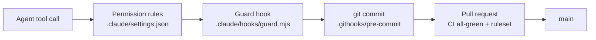

# agent-workspace-template

> Replace this heading and line with your project's name and one sentence about it.

A starting point for repositories where AI agents do real work safely. Every repository created from it carries its own gates, so the rules hold on any machine and in Claude Code cloud sessions, and GitHub refuses changes that skip them.

## Create a repository

```bash
gh repo create <name> --template git-commit-duke/agent-workspace-template --public --clone
cd <name>
bash scripts/protect-repo.sh git-commit-duke/<name>
```

Then fill in `CLAUDE.md` and `CONTEXT.md`, keep or swap the MIT `LICENSE`, and run `/superpowers:brainstorming` before writing code. For a web app, apply [the web add-on](docs/addons/web/README.md). A private repository on GitHub Free gets no ruleset or secret scanning ([ADR-0001](docs/adr/0001-security-baseline.md)); its gates are the hooks and CI.

## How this repository is protected



| Layer | Stops | Where |
|---|---|---|
| Permission rules | reading secret files, force-pushes, merges without the owner | [.claude/settings.json](.claude/settings.json) |
| Guard hook | tool calls and shell commands that touch a listed secret file; lockfile edits | [guard.mjs](.claude/hooks/guard.mjs), [secret-paths.txt](.claude/hooks/secret-paths.txt) |
| Commit gate | staged secret files and secrets, a failing typecheck | [.githooks/pre-commit](.githooks/pre-commit) |
| CI and ruleset | whatever got past: secret, code and workflow scans; tests; signed commits; a pull request for every change | [ci.yml](.github/workflows/ci.yml), [main.json](.github/rulesets/main.json) |

Why: [ADR-0001](docs/adr/0001-security-baseline.md) · [ADR-0002](docs/adr/0002-no-secrets-on-disk.md) · [ADR-0003](docs/adr/0003-gates-travel-with-the-repository.md)

## Cloud sessions

Open one repository per cloud session: a session holding several repositories loads none of their hooks or permission rules. The environment needs only network access **Trusted**; the session-start hook installs what the gates need. Plugins in cloud sessions come from your claude.ai account ([plugins](docs/agents/plugins.md)).

## Working here

The flow, roles and rules are in [CLAUDE.md](CLAUDE.md); vocabulary in [CONTEXT.md](CONTEXT.md); issues in [the issue-tracker guide](docs/agents/issue-tracker.md). After changing anything under `.claude/`, run `node .github/scripts/check-workspace.mjs`.

---

Created from [agent-workspace-template](https://github.com/git-commit-duke/agent-workspace-template).
